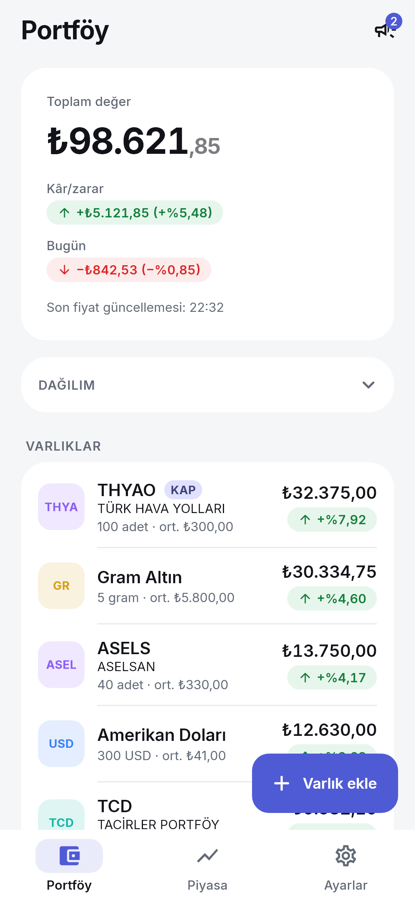
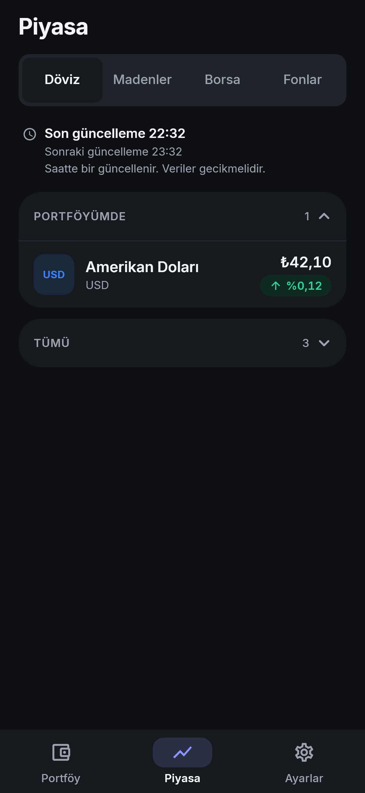
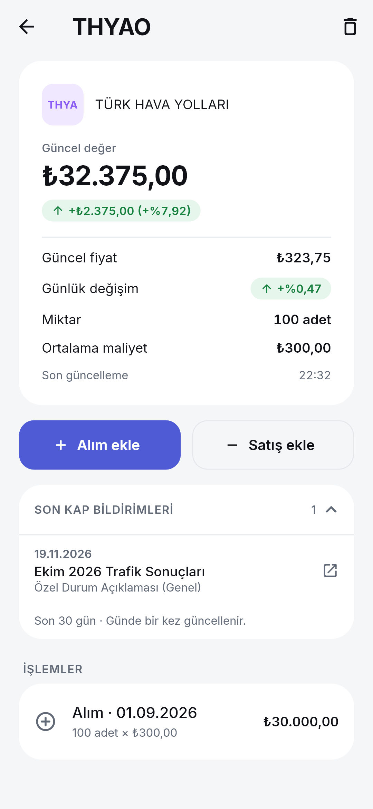

# Capira

Döviz, altın, gümüş, BIST hisseleri ve TEFAS fonlarını tek ekranda takip etmek için kişisel portföy uygulaması (Android, Flutter). Varlıklarını sen girersin; Capira güncel değerini, kâr/zararını ve portföydeki hisselerin KAP bildirimlerini gösterir.

> [!IMPORTANT]
> **Capira resmi bir Bürküt uygulaması değildir.** Fiyatlar için [Bürküt Portföy](https://burkutportfoy.com) herkese açık API'sini kullanan, topluluk tarafından geliştirilen bağımsız bir istemcidir. Her kullanıcı kendi ücretsiz API anahtarını kullanır.

> [!WARNING]
> **Yatırım tavsiyesi değildir.** Gösterilen fiyatlar gecikmeli olabilir (BIST verileri en az 15 dakika gecikmelidir) ve yalnızca bilgi amaçlıdır. Bürküt lisanslı bir veri dağıtıcısı değildir. Uygulama hiçbir garanti verilmeden sunulur (bkz. [LICENSE](LICENSE)).

| Portföy | Piyasa | Hisse detayı |
|---|---|---|
|  |  |  |

## Özellikler

- **Portföy:** alım/satım işlemleri, ağırlıklı ortalama maliyet, toplam değer, kâr/zarar, günlük değişim, tür veya varlık bazında dağılım.
- **Piyasa:** döviz, altın/gümüş (gram, çeyrek, yarım, tam, cumhuriyet, ata, gram gümüş), BIST'teki tüm hisseler ve TEFAS fonları; arama ile.
- **KAP bildirimleri:** portföydeki hisselerin son 30 günlük bildirimleri, KAP'taki asıl metne bağlantıyla. Yorum ya da "olumlu/olumsuz" etiketi yoktur.
- **Yedekleme:** portföyü tek bir dosyaya aktar, başka telefonda geri yükle.
- **Gizlilik:** sunucu yok. Tüm veriler telefondaki yerel veritabanında; API anahtarı şifreli depoda (Android Keystore) tutulur ve yedeğe girmez.
- Aydınlık / karanlık tema, Türkçe arayüz, büyük yazı boyutu desteği.

## Kurulum

Capira mağazada yok; kendi telefonuna kendin derleyip kurarsın.

1. [Flutter](https://docs.flutter.dev/get-started/install) **3.44.6** (stable) ve Android Studio kur.
2. Depoyu indir ve bağımlılıkları yükle:
   ```bash
   git clone https://github.com/oomerkaya/Capira.git
   cd Capira
   flutter pub get
   ```
3. Telefonu USB hata ayıklama açık bağla ve çalıştır:
   ```bash
   flutter run --release
   ```
   Ya da APK üret ve telefona kopyala: `flutter build apk --release` → `build/app/outputs/flutter-apk/app-release.apk`

## API anahtarı

1. [burkutportfoy.com/developers](https://burkutportfoy.com/developers) adresinden ücretsiz hesap aç ve bir API anahtarı oluştur (ayda 1.000 istek).
2. Capira'da **Ayarlar → Veri kaynağı → Bürküt API anahtarı**'na gir. Anahtar kaydedilmeden önce doğrulanır.

Anahtar olmadan fiyat ve KAP bildirimi gelmez; portföyü yine de girebilirsin.

## Veri ve güncelleme

Capira kotayı korumak için yalnızca uygulama açıkken ve aşağıdaki aralıklarla istek gönderir; ekranı aşağı çekmek bu aralıkları kısaltmaz.

| Veri | Ne zaman | İstek |
|---|---|---|
| Döviz, altın/gümüş | Her gün, saatte bir | Kategori başına 1 |
| BIST hisseleri | Hafta içi 10:00-18:00, saatte bir (tatilde yok) | Tüm piyasa için 1 |
| TEFAS fonları | Hafta içi, günde bir | 1 |
| KAP bildirimleri | Günde bir, 08:00'den sonra | 1 |
| Kota durumu | Ayarlar açılınca | Kota harcamaz |

Normal kullanımda ayda yaklaşık 250-700 istek harcanır. İnternet yoksa ya da kota dolduysa son bilinen fiyatlar gösterilir.

## Geliştirme

```bash
flutter analyze
flutter test
```

- Mimari: feature-first, katmanlı (data / domain / presentation); Riverpod, Drift (SQLite), go_router, dio. Para ve miktar hesapları `Decimal` ile yapılır.
- Proje kuralları: [`CLAUDE.md`](CLAUDE.md). Yol haritası: [`ROADMAP.md`](ROADMAP.md). Her fazın kararları ve ayrıntıları: [`docs/`](docs/README.md).
- API anahtarları asla koda, loglara, testlere veya git geçmişine girmez. Testler sahte anahtar ve kaydedilmiş örnek cevaplar (`test/fixtures/`) kullanır.

## Lisans

[MIT](LICENSE). Uygulamanın kullandığı açık kaynak paketlerin ve Inter yazı tipinin lisansları uygulamada **Ayarlar → Açık kaynak lisansları** altındadır.
