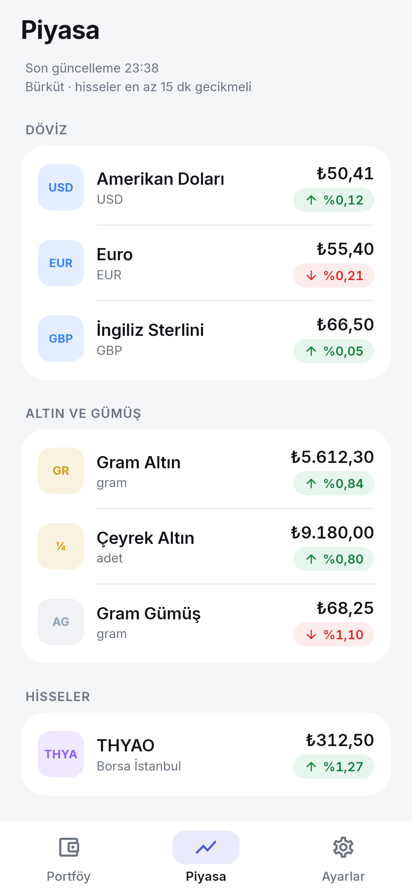
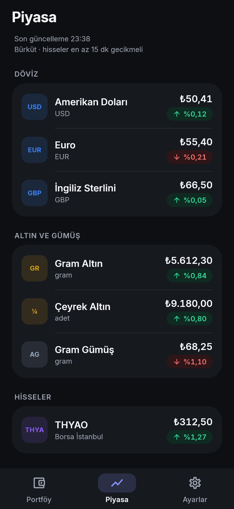
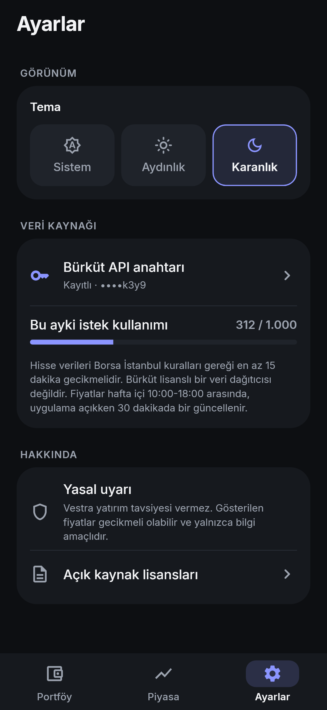
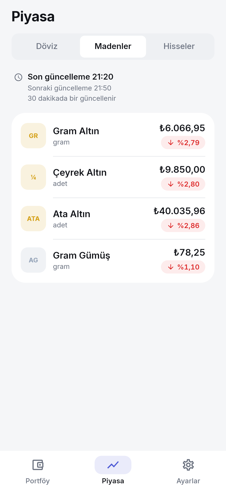
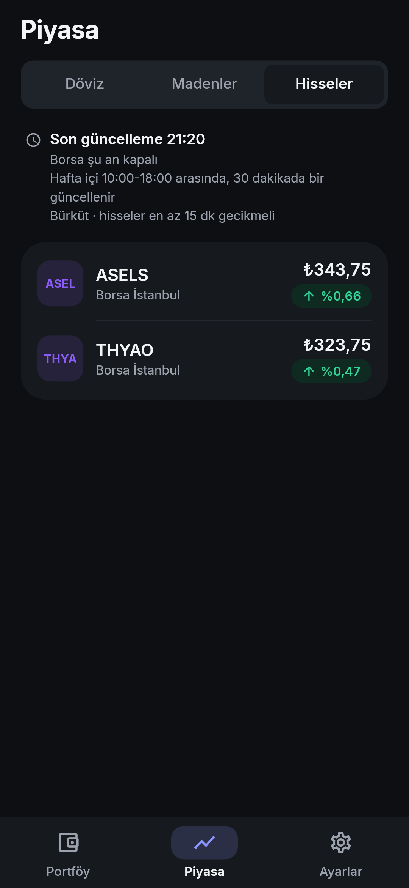
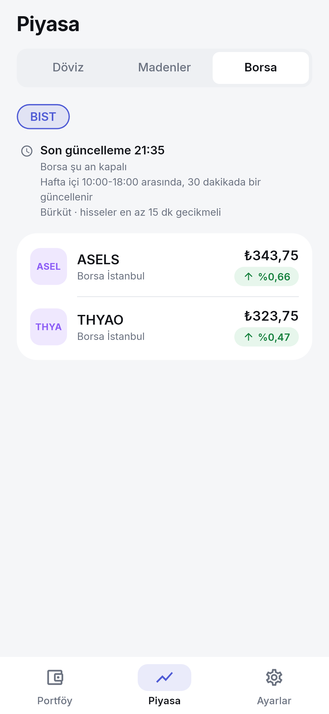

# Faz 3: Piyasa verisi

**Durum:** Bitti; gerçek API anahtarıyla canlı doğrulandı (2026-11-18, aşağıda "Canlı doğrulama") · **Tarih:** 2026-11-17

## Özet

Uygulama artık döviz, altın, gümüş ve hisse fiyatlarını çekiyor, cihazdaki veritabanına yazıyor ve internet yokken son bilinen değerleri gösteriyor.

- **Birincil kaynak: Bürküt.** Hisse, döviz, altın ve gümüş verisi gelir. Her kullanıcı kendi ücretsiz anahtarını girer.
- **Yedek kaynak: Frankfurter.** Döviz için kullanılır; anahtar gerektirmez.
- **API anahtarı** cihazda şifreli saklanır.
- **Aylık kota** uygulama içinde sayılır.
- **Otomatik yenileme** hafta içi seans saatlerinde, uygulama açıkken 30 dakikada bir yapılır.

| Piyasa (aydınlık) | Piyasa (karanlık) | Ayarlar (karanlık) |
|---|---|---|
|  |  |  |

Ekran görüntülerindeki fiyatlar **örnek veridir**; ekranı göstermek için önbelleğe elle yazıldı.

## Araştırma bulguları

| Konu | Bulgu | Kaynak |
|---|---|---|
| Frankfurter | 30 para birimi, **altın (XAU) ve gümüş (XAG) yok**. ECB günlük referans kuru; anahtarsız ve limitsiz. | `GET api.frankfurter.dev/v1/currencies` (canlı denendi) |
| Bürküt API adresi | `https://api.burkutportfoy.com/api/public/v1` | Resmi SDK `nodejs/src/client.ts` → `DEFAULT_BASE_URL` |
| Bürküt kimlik doğrulama | `X-API-Key: <anahtar>` başlığı. Anahtarsız istek `401 {"error":"UNAUTHORIZED"}` döner | SDK + canlı deneme |
| Bürküt uç noktaları | `GET /forex`, `/forex/{sym}`, `/gold`, `/gold/{sym}`, `/stocks?symbols=A,B`, `/stocks/{sym}` | SDK `resources/*.ts` |
| Yanıt biçimi | `{data: [...]}` ya da düz liste. Alanlar: döviz/altın `symbol, name, buying, selling, change_rate, time`; hisse `symbol, name, last_price, change_rate, time` | SDK `types.ts` |
| Hata kodları | 401 geçersiz anahtar, 403 yetki yok, 429 + `MONTHLY_QUOTA_EXCEEDED` aylık kota, 429 + `Retry-After` dakikalık limit | SDK `errors.ts`, `client.ts` |
| Ücretsiz plan | **Ayda 1.000 istek**, kredi kartı gerekmez. Dakikada 10 istek (REST spesifikasyonu) | burkutportfoy.com/developers (SSS), REST spesifikasyonu |
| Gecikme / yasal durum | BIST verisi en az 15 dk gecikmeli. Bürküt lisanslı veri dağıtıcısı değildir; eğitim/kişisel kullanım amaçlıdır | PyPI `burkut` sayfası |
| Altın sembolleri | İlk araştırmada yalnızca `ALTIN` ve `CEYREK_YENI` biliniyordu; tam liste REST spesifikasyonunda (aşağıda) | SDK README, REST spesifikasyonu |

## Bürküt API spesifikasyonu (sonradan eklendi, 2026-11-18)

Bürküt'ün yapay zekâ araçları için yayımladığı REST spesifikasyonu, ilk araştırmada dayanılan resmi SDK'dan **önemli noktalarda farklı** çıktı. SDK'ya göre yazılmış ilk kod, gerçek API'de dövizi ve hisseleri hiç gösteremeyecekti. Farklar ve yapılan düzeltmeler:

| Konu | SDK (ilk kod) | REST spesifikasyonu | Düzeltme |
|---|---|---|---|
| `/forex` alanları | `buying`, `selling`, `change_rate`, `time` | `price`, `changePercent`, `updatedAt` (alış/satış yok) | Esnek okuma (aşağıda). Döviz değerlemesinde `price` |
| `/stocks` alanları | `last_price`, `change_rate` | `price`, `change`, `changePercent`, `updatedAt` | Esnek okuma |
| `/stocks` parametresi | `?symbols=A,B` | Parametre yok; **560+ hissenin tamamı** 1 istekte | `symbols` yine gönderiliyor, sonuç **istemcide** portföy hisselerine süzülüyor |
| `/gold` değişim alanı | `change_rate` | `dailyChangePct`; ayrıca `unit` (`TL/Gr`, `TL/Adet`, `USD/Ons`) | Esnek okuma; TL olmayan birimler atlanıyor |
| Altın sembolleri | `ALTIN`, `CEYREK_YENI` (+ tahminler) | `ALTIN`, `CEYREK_YENI`, `YARIM`, `TAM`, `CUMHURIYET`, `ATA`, `XAUUSD`, `GUMTRY`, `PLATIN`, `PALADYUM`; takma adlar `GRAM_ALTIN`, `GAU`, `CEYREK`, `GUMUS` | Eşleme düzeltildi, **Ata Altın** eklendi. `XAUUSD` (USD), platin ve paladyum kapsam dışı |
| Dakikalık limit | belirtilmemiş | Ücretsiz: **10 istek/dk**; Pro: 60/dk, 50.000+/ay | Bizim yenileme en fazla 3 istek; sorun yok |
| Yanıt başlıkları | — | `X-RateLimit-Limit`, `X-RateLimit-Remaining`, `Retry-After`, **`X-Quota-Remaining`** | Aylık sayaç her yanıtta sunucudaki `X-Quota-Remaining` değerine eşitleniyor |
| `/forex` sembolleri | `USD` | 60+ kur; `USDTRY` ve `USD/TRY` biçimleri de tanınır | `USDTRY` / `USD/TRY` → `USD` normalleştirmesi |

**Esnek okuma kuralı** ([`burkut_dtos.dart`](../lib/features/market/data/dto/burkut_dtos.dart), tek `BurkutPriceDto`). Gerçek API hangi biçimi kullanırsa kullansın çalışır:
- Fiyat: `buying` → `price` → `last_price`. Altında alış fiyatı varsa o kullanılır; döviz ve hissede tek fiyat var.
- Değişim (%): `changePercent` → `dailyChangePct` → `change_rate`
- Zaman: `updatedAt` → `time`

Spesifikasyondaki örnek fiyatlar (USD 38,42 gibi) gösterim amaçlıdır.

## Kategori bazlı yenileme ve sekmeli piyasa ekranı (2026-11-18)

**Kullanıcı geri bildirimi:** Ekranı aşağı çekip her yenilediğinde Bürküt kotası azalıyordu; saat 18:14'te bile hisse isteniyordu. Sebep: pull-to-refresh tüm kuralları atlayıp her seferinde 2-3 istek gönderiyordu.

**Yeni kurallar** ([`refresh_policy.dart`](../lib/features/market/domain/services/refresh_policy.dart), `RefreshPolicy.isDue`):

| Kategori | Ne zaman istenir |
|---|---|
| Döviz | Her zaman; son başarılı güncellemeden ≥ 30 dk sonra |
| Altın/gümüş | Her zaman; son başarılı güncellemeden ≥ 30 dk sonra |
| Hisse | Yalnızca seans içinde (hafta içi 10:00-18:00, yarım gün 12:30, tatil yok); son başarılı güncellemeden ≥ 30 dk sonra. Tüm piyasa tek istekle (Faz 4 sonrası). Hiç hisse verisi yoksa seans dışında da bir kez çekilir |

- Pull-to-refresh aynı kurallara uyar, yani 30 dk dolmadan istek göndermez. Tek farkı: başarısız bir denemeden sonra beklemeden tekrar deneyebilir. İstek gitmediyse alt bilgide "Veriler güncel · sonraki güncelleme 18:44" ya da "Borsa şu an kapalı" görünür.
- Otomatik denemeler, başarısız bir denemeden sonra da 30 dk bekler; sunucu hatası her dakika tekrar istek harcamaz. HTTP 429'da backoff (1-30 dk, `Retry-After`) korunuyor.
- "Önbellek boşsa seans dışında bir kez yenile" kuralı kaldırıldı. Döviz ve maden zaten her saat yenilenebiliyor; hisseler yalnızca seans içinde.
- Her kategorinin son güncellemesi ayrı hesaplanır: önbellekteki o kategorinin en yeni `fetchedAt` değeri, hisselerde yalnızca portföydeki hisseler. Son deneme zamanı oturum içinde bellekte tutulur.

**Kod değişiklikleri:**
- `MarketRepository.refresh(categories, stockSymbols)`: yalnızca istenen kategoriler çekilir.
- `QuoteCategory.of(AssetType)`: türden kategoriye geçiş.
- `PriceRefreshController.refreshDue({manual})`: istenen kategorileri döndürür. Durum kategori bazlı: `refreshing` kümesi ve `failures` haritası.
- `RefreshPrices` use case'i kaldırıldı. Yerine `WatchHeldStockSymbols` geldi: portföyde miktarı > 0 olan hisseler, canlı. Hisse sekmesi yalnızca bunları gösterir.
- Piyasa ekranı: üstte hap biçimli **Döviz / Madenler / Hisseler** sekmeleri (`TabBar` + `TabBarView`, kaydırarak da geçilir). Her sekmenin kendi durum satırı var: son güncelleme, sonraki güncelleme ya da "Borsa şu an kapalı", güncelleme kuralı, kaynak. Bildirim kartları ve listesi de sekmeye özel. Anahtar uyarısı döviz sekmesinde çıkmaz, çünkü döviz anahtarsız da gelir.

| Döviz (aydınlık) | Madenler (aydınlık) | Hisseler, borsa kapalı (karanlık) |
|---|---|---|
|  |  |  |

**Testler:** `price_refresh_controller_test.dart` (yeni, 9 test) şunları doğrular:
- 30 dk içinde tekrar çekmek istek göndermez.
- 30 dk sonra yeniden çekilir.
- 18:14'te ve hafta sonu yalnızca döviz ve maden istenir.
- Kategorilerin takvimleri birbirinden bağımsızdır.
- Hisse yoksa hisse isteği gitmez.
- Başarısız denemeden sonra otomatik yenileme bekler, elle yenileme dener.
- Hatalar kategori bazlı tutulur.

`refresh_policy_test.dart` yeni kurallara göre yeniden yazıldı. Repository'ye "yalnızca istenen kategori" testi eklendi.

## "Borsa" sekmesi ve ABD borsası değerlendirmesi (2026-11-18)

- "Hisseler" sekmesinin adı **Borsa** oldu. İçinde şimdilik tek bir **BIST** seçimi var (`_ExchangeSelector`); ileride başka borsalar yan yana eklenebilir.

- **ABD borsası ertelendi.** Ücretsiz seçenekler araştırıldı: Finnhub (dakikada 60 istek, kişisel kullanım), Twelve Data (günde 800, gecikmeli), Alpha Vantage (günde 25). En uygunu Finnhub. Ancak [kullanım şartları](https://finnhub.io/terms-of-service) şöyle diyor:
  - "Tüm planlar **kesinlikle kişisel kullanım** içindir."
  - "Verileri veya verilerden türetilen sonuçları üçüncü taraflarla Finnhub'ın **yazılı onayı olmadan** paylaşmayacaksınız."
  - "Abonelik sona erdiğinde tüm veriler silinmelidir."

  Kodun açık kaynak olması ve her kullanıcının kendi anahtarını kullanması bu şartlarla çelişmiyor gibi görünüyor. Yine de kullanıcı kararıyla, önce Finnhub'dan yazılı onay beklenecek. Onay gelirse uyulacak kurallar:
  - Gerçek Finnhub yanıtları repoya konmaz; testler uydurma veriyle yazılır.
  - README'de gerçek ABD fiyatı gösterilmez.
  - Finnhub anahtarı silinince ABD fiyat önbelleği de silinir.
  - Ortak anahtar ya da sunucu kullanılmaz.

  Alınmış kararlar: ABD hisselerinde maliyet **USD** girilecek; ABD seansı NYSE takvimine göre (İstanbul saatiyle yaklaşık 16:30-23:00, ABD kış saatinde 17:30-00:00) olacak.

## Alınan kararlar

| Karar | Alternatif | Gerekçe |
|---|---|---|
| **Bürküt birincil, Frankfurter yalnızca döviz yedeği** | Döviz her zaman Frankfurter'dan | Kullanıcı tercihi. Tek tutarlı, gün içi güncellenen kaynak. Anahtar yoksa ya da kota dolmuşsa döviz yine güncellenir |
| **Otomatik yenileme 30 dk'da bir** (CLAUDE.md'deki 15 dk yerine; 2026-11-18'den beri kategori bazlı, yukarıya bakın) | 15 dk + %90'da durdurma | Kullanıcı tercihi. Yenileme başına en fazla 3 istek gidiyor; 15 dk'da bir ve gün boyu açık kullanımda ayda yaklaşık 2.100 istek eder ve kota aşılır |
| Döviz ve altında **alış (`buying`) fiyatı** kullanılır | Satış fiyatı, ortalama | Elindeki varlığı bugün satsan alacağın değer; portföy için temkinli değer |
| Yenileme sırası döviz → maden → hisse. Anahtar eksik/reddedilmiş ya da kota dolmuşsa kalan Bürküt çağrıları **atlanır** | Her kategoriyi ayrı denemek | Boşa istek (ve kota) harcanmaz |
| Anahtar yoksa ya da kota doluysa **istek hiç gönderilmez**, kontrol yerelde yapılır | İsteği gönderip 401/429 beklemek | Kota korunur |
| Kota sayacı uygulamanın kendi tahmini (`app_settings`, aylık). Sunucu "kota doldu" derse o geçerlidir | Sunucudan kota sorgulamak | Böyle bir uç nokta bulunamadı |
| Kota dolsa da otomatik yenileme durmaz | Tamamen durdurmak | Bürküt'e istek gitmez; döviz ücretsiz yedekten güncellenmeye devam eder |
| Saat dilimi sabit **UTC+3** | `timezone` paketi | Türkiye 2016'dan beri yaz saati uygulamıyor; paket eklemeye gerek yok |
| Tatil takvimi `assets/data/market_holidays.json` | Kodda sabit liste | CLAUDE.md kuralı; kod değişmeden güncellenebilir |
| `AssetType` `core/domain/instrument.dart`'a taşındı, `Instrument` bir Dart record | Portföy domain'inde bırakmak | Piyasa ve portföy ikisi de kullanıyor. Record yapısal eşitlik sağlıyor |
| `Failure` artık `Exception` uyguluyor | — | Riverpod stream'lerinde hata olarak fırlatılabilsin |

## Veritabanı: şema v2 (ilk migration)

`price_cache` tablosuna üç kolon eklendi: `name` (sağlayıcının verdiği ad), `change_percent` (günlük değişim, Decimal TEXT), `as_of` (sağlayıcının fiyat zamanı).

- [`app_database.dart`](../lib/core/database/app_database.dart): `schemaVersion = 2`, `onUpgrade: stepByStep(from1To2: ...)` ile üç `addColumn`.
- `drift_schemas/vestra/drift_schema_v2.json` ve `lib/core/database/app_database.steps.dart` üretildi.
- [`test/drift/vestra/migration_test.dart`](../test/drift/vestra/migration_test.dart):
  - v1 → v2 şemasının kodla birebir aynı olduğunu doğrular.
  - v1'de doldurulmuş varlık, işlem, fiyat ve ayar satırlarının v2'ye **kayıpsız** geçtiğini doğrular.

## Yapılanlar

### `core`

| Dosya | İçerik |
|---|---|
| `domain/instrument.dart` | `AssetType`, `Instrument` (record) |
| `error/failure.dart` | Yeni `QuotaExceededFailure`; `AuthFailure(missingKey)` ile "anahtar yok" ve "anahtar reddedildi" ayrımı; `Failure implements Exception` |
| `network/dio_factory.dart` | Zaman aşımları (bağlantı 10 sn, okuma 15 sn). **Loglama interceptor'ı yok**; başlıklarda anahtar var |
| `network/dio_failure_mapper.dart` | `DioException` → `Failure`. 429'u kota/limit diye ayırır, `Retry-After`'ı okur. Yanıt gövdesi mesaja kopyalanmaz |
| `l10n/failure_messages.dart` | Her `Failure` için Türkçe kullanıcı mesajı |
| `utils/formatters.dart` | `DateFormatters.shortDateTime` (`14:32` / `17.11 14:32`), `turkishUpperCase` |
| `widgets/instrument_avatar.dart` | Türe göre renkli kare avatar |
| `widgets/section_header.dart` | Artık Türkçe büyük harf kullanıyor ("HİSSELER") |

### Piyasa: domain (`lib/features/market/domain/`)

| Dosya | İçerik |
|---|---|
| `entities/quote.dart` | `Quote` (instrument, priceTry, source, fetchedAt, name?, changePercent?, asOf?), `QuoteSource`, `QuoteCategory` |
| `entities/quota_usage.dart` | Ay (`YYYY-MM`), kullanılan, limit (1.000), sunucunun "doldu" bayrağı |
| `entities/market_calendar.dart` | Kapalı günler ve yarım günler, JSON'dan okunur |
| `providers/price_providers.dart` | `FxRateProvider`, `MetalPriceProvider`, `StockPriceProvider` arayüzleri |
| `repositories/market_repository.dart` | `watchQuotes`, `refresh(stockSymbols)`, `quotaUsage`, `RefreshReport` |
| `services/refresh_policy.dart` | Saf kurallar: seans açık mı, otomatik yenileme zamanı geldi mi, backoff süresi |
| `usecases/refresh_prices.dart` | Portföyde **miktarı > 0 olan** hisseleri toplar, yenilemeyi tetikler |

**Yenileme kuralları (`RefreshPolicy`):**
- Seans hafta içi 10:00-18:00 (İstanbul); yarım günlerde 12:30'a kadar, tatillerde kapalı.
- Otomatik yenileme seans içinde, son yenilemeden en az 30 dk sonra yapılır. Önbellek boşsa her zaman yapılır.
- Backoff 1, 2, 4, 8, 16, 30, 30… dakika. Sunucunun `Retry-After` değeri daha uzunsa o kullanılır.
- Elle yenileme (aşağı çekme) seans saatine bakmaz.

### Piyasa: data (`lib/features/market/data/`)

| Dosya | İçerik |
|---|---|
| `datasources/burkut_remote_data_source.dart` | `/forex`, `/gold`, `/stocks?symbols=` (dio, `X-API-Key`) |
| `datasources/frankfurter_remote_data_source.dart` | `/latest?base=TRY&symbols=...` |
| `datasources/quota_local_data_source.dart` | Aylık sayaç (`app_settings` → `burkut_quota`, JSON); `syncRemaining` ile sunucunun `X-Quota-Remaining` değerine eşitlenir |
| `datasources/price_cache_local_data_source.dart` | Önbelleği izleme ve toplu upsert |
| `dto/json_parsing.dart`, `dto/burkut_dtos.dart` | Esnek JSON okuma: sayı ya da metin, virgüllü ondalık, `{data:[]}` ya da düz liste, SDK ve REST spesifikasyonu alan adları. Bozuk öğe atlanır. `BurkutResponse` kalan kotayı da taşır |
| `mappers/burkut_symbols.dart` | Bürküt sembolü → Vestra enstrümanı. XAU/XAG/TRY döviz sayılmaz |
| `mappers/quote_mappers.dart` | `Quote` ↔ `price_cache` satırı. Bilinmeyen tür/kaynak satırları atlanır |
| `providers/burkut_price_provider.dart` | Üç fiyat arayüzü + `ApiKeyValidator`. Anahtar ve kota kontrolü, sayaç, hata eşleme |
| `providers/frankfurter_fx_provider.dart` | TRY bazlı kurları ters çevirir (`1 / oran`, 6 basamak) |
| `repositories/market_repository_impl.dart` | Döviz yedeği, atlama mantığı, önbelleğe yazma |

### Ayarlar

| Dosya | İçerik |
|---|---|
| `domain/repositories/api_key_repository.dart` | `ApiKeyRepository`, `ApiKeyValidator` |
| `domain/usecases/save_burkut_key.dart` | Boşlukları kırpar, biçimi kontrol eder (10-200 karakter, harf/rakam/`_`/`-`). Bürküt'e 1 istekle doğrulatır, sonra kaydeder |
| `data/repositories/api_key_repository_impl.dart` | `flutter_secure_storage` (Android Keystore). Hata nesnesi loglanmaz |
| `presentation/widgets/data_source_section.dart` | Anahtar durumu (son 4 karakter), kota çubuğu (ör. `312 / 1.000`), veri kaynağı notu |
| `presentation/widgets/api_key_sheet.dart` | Anahtar girişi (gizle/göster), "Doğrula ve kaydet", "Anahtarı sil", Türkçe hata mesajları |

### Sunum

- `market/presentation/price_refresh_controller.dart`:
  - Dakikada bir yenileme kurallarını kontrol eder.
  - Uygulama öne gelince (`AppLifecycleListener.onResume`) de kontrol eder; arka plandayken hiçbir şey yapmaz.
  - Hız limiti veya tam ağ kesintisinde backoff uygular.
  - `app.dart` uygulama boyunca canlı tutar.
- `market/presentation/market_screen.dart`:
  - Aşağı çekerek yenileme.
  - "Son güncelleme" ve kaynak satırı; yedek kaynak kullanılıyorsa belirtilir.
  - Anahtar yoksa "Ayarlara git" kartı; kota/ağ/anahtar sorunlarında bilgi kartı.
  - Döviz, Altın ve gümüş, Hisseler bölümleri.
- `market/presentation/widgets/quote_tile.dart`: avatar, ad, alt satır (kod / gram / adet / Borsa İstanbul), fiyat (10 TL altı 4 basamak), değişim hapı.
- `market/presentation/instrument_labels.dart`: Türkçe adlar ve sıralama (USD, EUR, GBP, gram, çeyrek, …).

## Güvenlik

- Anahtar yalnızca `flutter_secure_storage`'da durur; DB'de, logda, testte ve kodda yok. Testlerde sahte anahtar ve sahte yanıt kullanıldı.
- dio'da loglama yok. Hata mesajlarına yanıt gövdesi kopyalanmaz.
- Ayarlar ekranında anahtarın yalnızca son 4 karakteri görünür.

## Testler

Toplam **127 test**, hepsi geçti (Faz 2 sonunda 52; REST spesifikasyonu düzeltmesiyle +10; canlı doğrulamayla +6; kategori bazlı yenilemeyle +14).

| Dosya | Kapsam |
|---|---|
| `test/features/market/data/burkut_live_fixtures_test.dart` | Gerçek Bürküt yanıtlarıyla (fixture): 21 döviz (XDR hariç) `buyRate`'ten, 7 TL maden (XAUUSD hariç) `buying`'den, hisse fiyat/değişim, kota başlıklarıyla sayaç eşitleme |
| `test/features/market/data/burkut_remote_data_source_test.dart` | Sahte HTTP adaptörüyle: `X-API-Key` gönderimi, `X-Quota-Remaining` okuma, `{data:[]}` zarfı, `/stocks` tüm piyasa yanıtının portföy hisselerine süzülmesi |
| `test/features/market/domain/refresh_policy_test.dart` | Seans saatleri, İstanbul saati, hafta sonu, tatil, yarım gün, 30 dk aralık, önbellek boşken yenileme, backoff dizisi ve `Retry-After`, takvim JSON'u |
| `test/features/market/data/parsing_and_errors_test.dart` | Decimal/tarih/liste okuma, DTO'lar, `DioException` → `Failure` (ağ, 401/403, kota, limit + `Retry-After`, 5xx) |
| `test/features/market/data/providers_test.dart` | Bürküt eşleme ve alış fiyatı. Anahtarsız ya da kota doluyken istek gitmemesi, sunucu kota yanıtında sayacın kilitlenmesi, toplu hisse isteği, `validate`, Frankfurter ters çevirme, aylık sayaç sıfırlanması |
| `test/features/market/data/market_repository_impl_test.dart` | Normal akış, anahtar yokken yedek kaynak ve atlama, ağ hatasında devam, hisse yoksa çağrı yok, önbellek güncelleme, her şey başarısızken eski önbelleğin korunması |
| `test/features/settings/save_burkut_key_test.dart` | Kırpma ve kaydetme, boş/bozuk biçimde ağa gitmeme, reddedilen anahtarı saklamama |
| `test/drift/vestra/migration_test.dart` | v1 → v2 şema ve veri bütünlüğü |
| `test/core/formatters_test.dart` | `turkishUpperCase` eklendi |

## Doğrulama

| Komut | Sonuç |
|---|---|
| `dart format --set-exit-if-changed lib test` | Temiz |
| `flutter analyze` | No issues found |
| `flutter test` | 127/127 |
| `flutter build apk --debug` | Başarılı |
| Canlı: `GET api.frankfurter.dev/v1/latest?base=TRY&symbols=...` | Beklenen biçim; USD = 1 / 0,019836 ≈ ₺50,41 |
| Canlı: `GET api.burkutportfoy.com/api/public/v1/gold` (anahtarsız) | `401 UNAUTHORIZED`; adres ve hata biçimi doğru |

## Canlı doğrulama (2026-11-18, kullanıcının anahtarıyla)

Anahtar, proje dışındaki bir dosyadan (`%USERPROFILE%\.vestra\burkut_key`) okundu; ekrana, loga veya repoya yazılmadı. 3 istek atıldı (`/forex`, `/gold`, `/stocks?symbols=THYAO,ASELS`); üçü de `200 OK`.

| Konu | Gerçek davranış | Sonuç |
|---|---|---|
| Zarf | `{"data": [...]}` | Destekleniyordu |
| **`/forex` alanları** | `buyRate`, `sellRate`, `rate`, `currentPrice`, `dailyChangePct`, `dailyChangePercent`, `updatedAt`. **`buying` ve `price` yok** | **Ne SDK ne REST spesifikasyonu doğruydu.** Düzeltilmeseydi döviz yine boş gelecekti. Fiyat sırasına `buyRate`, `rate`, `currentPrice` eklendi |
| `/forex` sembolleri | 22 adet: AED, AUD, AZN, CAD, CHF, CNY, DKK, EUR, GBP, JPY, KRW, KWD, KZT, NOK, PKR, QAR, RON, RUB, SAR, SEK, USD, XDR | `XDR` (IMF özel çekme hakkı) atlanıyor. Yeni 10 para birimine Türkçe ad eklendi |
| `/gold` | `buying`, `selling`, `price`, `currentPrice`, `dailyChangePct`, `unit`. Semboller: `ALTIN, ATA, CEYREK_YENI, CUMHURIYET, GUMTRY, TAM, XAUUSD, YARIM` | REST spesifikasyonuyla uyumlu; eşleme doğru. `close`, `high`, `low` alanları `0` geliyor; sıfır fiyat artık "yok" sayılıyor |
| `/stocks?symbols=` | Parametre **dikkate alınıyor**; yalnızca 2 hisse döndü. Alanlar `price`, `currentPrice`, `changePercent`, `dailyChangePct` | Destekleniyordu |
| Kota başlıkları | `X-Quota-Limit: 1000`, `X-Quota-Remaining`, `X-Quota-Reset: 1796083200` (= 2026-12-01 00:00 UTC), `X-Ratelimit-Limit: 10`, `X-Ratelimit-Remaining` | Kalan ve limit okunup sayaca yazılıyor (ücretli plan da doğru görünür). Sıfırlama takvim ayı başı UTC; uygulamanın ay mantığıyla uyumlu |
| Karakter kodlaması | Geçerli UTF-8 ("Gram Altın") | Sorun yok |

Bu yanıtlar `test/fixtures/burkut/` altına kaydedildi; içinde anahtar olmadığı kontrol edildi. `test/features/market/data/burkut_live_fixtures_test.dart` gerçek yanıtları uçtan uca (HTTP → DTO → `Quote`) test ediyor. Bürküt biçim değiştirirse bu dosyalar yenilenir ve hangi alanın bozulduğu testte görünür.

## Bilinen eksikler / sonraki faza devredilenler

- Portföy değerlemesi (miktar × güncel fiyat) ve kâr/zarar Faz 4'te.
- Fiyatı olmayan varlıklarda (ör. anahtar yokken altın) "fiyat yok" gösterimi Faz 4'te.
- Tatil takvimi 2026-2027'yi kapsıyor; her yıl Borsa İstanbul duyurusuyla güncellenmeli (Faz 5 README notu).
- Bürküt'ün kota yenileme günü bilinmiyor; uygulama takvim ayını esas alıyor.
