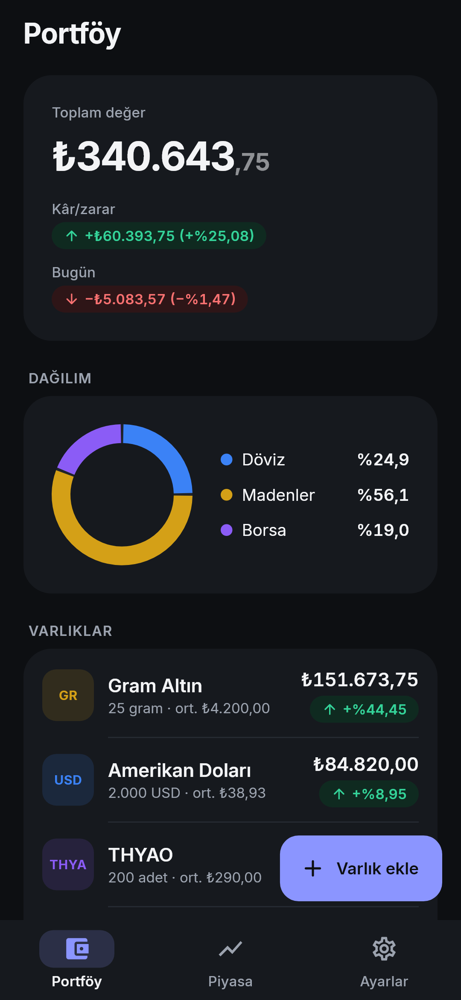
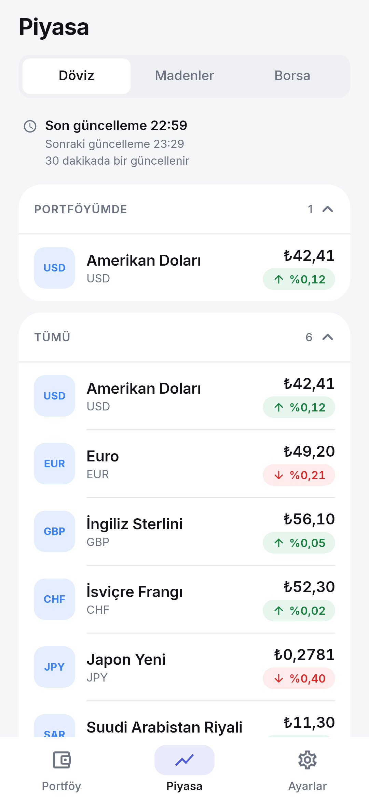

# Faz 4: Özellikler

**Durum:** Bitti · **Tarih:** 2026-11-18

## Özet

Uygulama artık uçtan uca kullanılabilir. Kullanıcı:
- döviz, altın/gümüş ve BIST hissesi ekleyebilir; alım/satım işlemlerini düzenleyip silebilir,
- portföyünün toplam değerini, kâr/zararını, günlük değişimini ve kategori dağılımını (halka grafik) görebilir,
- her varlığın detayını ve işlem geçmişini inceleyebilir.

Fiyat güncelleme ekranı ve "son güncelleme" göstergesi Faz 3'te tamamlanmıştı (Piyasa sekmesi).

| Portföy (aydınlık) | Portföy (karanlık) | Varlık detayı | Varlık ekleme |
|---|---|---|---|
|  |  |  |  |

Ekran görüntülerindeki portföy ve fiyatlar **örnek veridir**.

## Alınan kararlar

| Karar | Alternatif | Gerekçe |
|---|---|---|
| BIST hissesi **arama listesinden** seçilir | Sembolü elle yazmak | Kullanıcı tercihi. Yanlış sembol girilemez, şirket adı görünür. Liste yoksa (anahtar yok) sembol elle yazılabilir |
| Hisse listesi Bürküt `/stocks` (tüm piyasa, **1 istek**) ile alınır, `app_settings`'te JSON olarak (~25 KB) **7 gün** önbelleklenir | Her açılışta çekmek; ayrı tablo | Kota korunur; ayrı tablo için migration gerekmez. Yenileme başarısızsa eski liste kullanılır |
| Alım formunda fiyat, tarih **bugünse** önbellekteki güncel fiyatla dolu gelir | Hep boş | Kullanıcı tercihi. Geçmiş tarih seçilince otomatik doldurulan fiyat temizlenir; kullanıcı fiyatı değiştirirse dokunulmaz |
| Dağılım **halka grafik**, kendi `CustomPainter`'ımızla | Grafik paketi (fl_chart vb.) | Kullanıcı tercihi; paket eklemeye gerek yok. Yüzdeler `Decimal` ile hesaplanır, `double`'a yalnızca çizim için çevrilir |
| Değerleme: miktar × önbellekteki fiyat. Fiyatı olmayan varlık listede "Fiyat yok" olarak durur, **toplamlara katılmaz**, altta not düşülür | Son alış fiyatıyla değerlemek | Uydurma değer göstermemek |
| Kâr/zarar toplamı yalnızca **fiyatı ve maliyeti bilinen** varlıklardan | Bilinmeyen maliyeti 0 saymak | Yüzde bozulmasın (miras altın gibi) |
| Günlük değişim: önceki kapanış = fiyat / (1 + %/100) | Ayrı API çağrısı | Ek istek yok; Bürküt günlük yüzdeyi zaten veriyor |
| Hisselerde başlık **sembol** (THYAO); şirket adı detayda | Şirket adı | Bürküt adları uzun ve büyük harf ("TURK HAVA YOLLARI A.O."); listede kesiliyordu |
| Ekleme ve düzenleme **tek form** (`TransactionFormScreen.add/.edit`) | İki ayrı ekran | Tek kaynak; doğrulama use case'lerde |
| Form ve detay ekranları **kök navigator'da** (alt menünün üstünde) | Sekme içinde | Tam ekran form, geri tuşu doğal çalışır |
| Türkçe sayı girişi: `12,5` · `1.250,75` · `1250.75` · `1.250` (= 1250) | Yalnızca nokta | Türk kullanıcı alışkanlığı (`parseDecimalInput`) |
| Bildirimler (snackbar) **sıraya girmez**, öncekinin yerine geçer | Varsayılan kuyruk | Testte bulundu: "Varlık silindi" mesajı önceki "İşlem kaydedildi"nin arkasında saniyelerce bekliyordu |

## Yapılanlar

### Domain

| Dosya | İçerik |
|---|---|
| `portfolio/domain/services/portfolio_valuator.dart` | Saf değerleme: açık varlıklar, toplam değer, kategori dağılımı, gerçekleşmemiş K/Z (₺ ve %), günlük değişim, fiyatı olmayan sayısı. Sıralama: değere göre azalan, fiyatsızlar sonda |
| `portfolio/domain/entities/portfolio_summary.dart` | `ValuedHolding`, `PortfolioSummary` |
| `portfolio/domain/instrument_catalog.dart` | Seçilebilir dövizler (Bürküt'ün canlıda verdiği 21 kur) ve madenler (gram, çeyrek, yarım, tam, cumhuriyet, ata, gram gümüş) |
| `market/domain/entities/stock_listing.dart` | Sembol + şirket adı |
| `market/domain/providers/price_providers.dart` | Yeni `StockListingProvider` arayüzü |
| `market/domain/repositories/stock_directory_repository.dart` | Önbellekli hisse listesi arayüzü |

### Data

| Dosya | İçerik |
|---|---|
| `burkut_remote_data_source.dart` | `getAllStocks` (`/stocks`, parametresiz) |
| `burkut_price_provider.dart` | `StockListingProvider` uygulaması; `_call` genel tipe çevrildi (anahtar/kota kontrolleri aynen geçerli) |
| `stock_listing_local_data_source.dart` | `app_settings` → `bist_listings` JSON |
| `stock_directory_repository_impl.dart` | 7 gün taze; değilse çek, başarısızsa eski liste; hiç yoksa hata |

### Core

| Dosya | İçerik |
|---|---|
| `utils/decimal_input.dart` | `parseDecimalInput`, `formatDecimalInput` |
| `widgets/donut_chart.dart` | Halka grafik (dilimler arası boşluk, arka iz) |
| `widgets/confirm_dialog.dart` | Silme onayı |
| `widgets/messages.dart` | `ScaffoldMessengerState.showMessage`, kuyruksuz bildirim |
| `router/app_routes.dart` | Rota sabitleri ve yardımcıları (`assetDetail`, `editTransaction`, `addTransactionFor`) |
| `router/app_router.dart` | Kök navigator anahtarı; `/portfolio/add`, `/portfolio/asset/:id`, `/portfolio/asset/:id/transaction/:tx` |

### Sunum (`portfolio/presentation/`)

| Dosya | İçerik |
|---|---|
| `portfolio_screen.dart` | Özet kartı, dağılım, varlık listesi, "Varlık ekle" butonu, fiyatı olmayanlar notu |
| `widgets/portfolio_summary_card.dart` | Toplam değer (kuruş küçük), K/Z ve bugün hapları |
| `widgets/allocation_card.dart` | Halka grafik ve açıklama (Döviz / Madenler / Borsa) |
| `widgets/holding_tile.dart` | Ad, "25 gram · ort. ₺4.200,00", değer, K/Z % |
| `widgets/instrument_picker_sheet.dart` | Kategoriye göre liste (güncel fiyatlarla); hisselerde arama (sembol veya ad, Türkçe büyük harf), listede yoksa elle sembol |
| `screens/transaction_form_screen.dart` | Tür, varlık, alım/satım, miktar (birimli), birim fiyat (otomatik doldurma), tarih, not; düzenlemede silme |
| `screens/asset_detail_screen.dart` | Değer, K/Z, miktar, ortalama maliyet, gerçekleşen K/Z; Alım/Satış ekle; işlem listesi; varlığı silme |
| `screens/edit_transaction_route.dart` | Rota parametrelerinden varlık ve işlemi yükler |
| `portfolio_labels.dart` | Kategori adı ve rengi, görünen ad, birim (USD / gram / adet), hata mesajları |
| `portfolio_providers.dart` | `holdingsProvider`, `portfolioSummaryProvider`, `assetTransactionsProvider(assetId)` |

### Metinler

`app_tr.arb`'ye yaklaşık 50 yeni metin eklendi: form, detay, onaylar, hatalar, seçici. Fazla satış uyarısı şöyle: "Bu tarihte elindeki miktardan fazla satamazsın; önceki bir alım silinirse ya da azalırsa da olmaz".

## Testler

Toplam **153 test**, hepsi geçti (Faz 3 sonunda 127, +26).

| Dosya | Kapsam |
|---|---|
| `test/features/portfolio/domain/portfolio_valuator_test.dart` | Toplam, maliyet, K/Z %, kategori dağılımı, sıralama; fiyatsız varlığın hariç tutulması; bilinmeyen maliyet; günlük değişim (+%25 → önceki 400, şimdi 500); kapalı pozisyon |
| `test/core/decimal_input_test.dart` | 10 Türkçe ve İngilizce biçim; geçersiz girişler; biçimle → ayrıştır gidiş-dönüşü |
| `test/features/market/data/stock_directory_repository_impl_test.dart` | İlk çekme ve sıralama; 6 gün istek yok; 7. gün yenileme; hata → eski liste; liste ve anahtar yok → hata |
| `test/features/portfolio/presentation/portfolio_flow_test.dart` | **Uçtan uca arayüz:** dolar ekle (fiyat otomatik dolu) → portföyde ₺4.210,00 ve dağılım; fazla satış uyarısı; detaydan işlemi düzenle (100 → 200 USD); varlığı sil → boş portföy |
| `test/app_test.dart` | Drift akışlarının kapanış zamanlayıcıları için her testin sonunda uygulama kaldırılıyor |

## Doğrulama

| Komut | Sonuç |
|---|---|
| `dart format --set-exit-if-changed lib test` | Temiz |
| `flutter analyze` | No issues found |
| `flutter test` | 153/153 |
| `flutter build apk --debug` | Başarılı |
| Görsel önizleme (geçici golden test, Inter fontu ile) | Portföy (aydınlık/karanlık), detay, ekleme formu; iki düzeltme yapıldı (hisse başlığı sembol, "Madenler" etiketi) |

## Faz 4 sonrası değişiklikler (2026-11-18)

Kullanıcı geri bildirimleriyle sırayla yapıldı; son durum aşağıda.

### 1. Piyasa: "Portföyümde / Tümü" bölümleri

- Her piyasa sekmesinde iki açılır-kapanır bölüm var (`CollapsibleSection`):
  - **Portföyümde:** O kategoride elde tutulan enstrümanlar ve sayısı.
  - **Tümü:** Kategorideki her şey.
- Açık/kapalı durumu sekme değişince korunuyor (`PageStorage`). Portföyde o kategoriden bir şey yoksa "Tümü" açık başlıyor.
- **İstek sayısı artmadı:**
  - `/forex` ve `/gold` zaten tüm listeyi veriyordu.
  - `/stocks` parametresiz tüm piyasayı (634 hisse) yine **tek istekte** döndürüyor. Hisselerde düzenli güncelleme artık tüm piyasa.
- **Borsa "Tümü":** Arama kutusu var (sembol veya şirket adı, Türkçe büyük harf). Liste 50'şer satır açılıyor ("50 hisse daha göster"). Hisse satırında başlık sembol, alt yazı şirket adı.

| Döviz | Borsa |
|---|---|
|  |  |

### 2. BIST 30 / BIST 100 denendi ve kaldırıldı

- **Endeks verisi Bürküt'te yok.** Kullanıcının anahtarıyla denendi:
  - `/indices` → 404.
  - `/stocks?index=XU030` → parametre yok sayıldı.
- **Denenen çözüm:** Endeks üyeleri bir JSON dosyasında (2026 4. çeyrek listesi) tutuldu.
- **Kaldırıldı:** Endeks listesi 3 ayda bir değişiyor ve elle güncelleme gerektiriyor; kullanıcı bu güncellik sorunu nedeniyle istemedi. Dosya, entity, provider'lar ve testleri kaldırıldı; yerine Borsa'da "Tümü" bölümü geldi.

### 3. Seans kapalıyken eklenen hisse

- **İlk sorun:** Hisseler yalnızca seans içinde çekildiği için seans kapalıyken eklenen hisse "Fiyat yok" kalıyordu.
- **Geçici çözüm:** Önce "fiyatı olmayan hisse için tek istek" kuralı eklendi.
- **Son çözüm:** Hisseler tüm piyasa olarak çekildiğinden yeni eklenen hissenin fiyatı son anlık görüntüde zaten var, ayrı istek gerekmiyor. Bu yüzden ayrı istek kuralı (`isMissingStocksDue`, `WatchHeldStockSymbols`) **kaldırıldı**.
- **Tek kural:** Bir kategori **hiç çekilmemişse** (boş önbellek) seans fark etmeksizin hemen bir kez çekilir. Uygulama ilk kez gece ya da hafta sonu açılsa da hisse fiyatları gelir. Sonrasında hisseler yalnızca seans içinde 30 dakikada bir güncellenir.
- **Kalıcı düzeltme:** Ara adımda testler bir açık yakaladı: başarısız normal istekten hemen sonra tekrar deneniyordu. Bu düzeltme kalıcı; otomatik yeniden deneme 30 dakika bekliyor.

### 4. Ons altın eklendi, sonra kaldırıldı

- Bürküt'ün canlı `/gold` listesindeki ons altın (`XAUUSD`, USD/ons) bir süre USD/TRY ile TL'ye çevrilerek eklendi.
- Kullanıcı istemediği için **kaldırıldı**; çevirme kodu da silindi.
- Madenler: gram, çeyrek, yarım, tam, cumhuriyet, ata altın ve gram gümüş.
- **Kalıntı temizliği:** Kaldırıldıktan sonra da ons, telefonun önbelleğinde kalan eski satırdan görünmeye devam etti. İki çözüm uygulandı:
  - Desteklenmeyen maden satırları artık gösterilmiyor (`MarketRepositoryImpl._isSupported`).
  - Bir kategori sağlayıcının **tam listesiyle** güncellenince listede olmayan eski satırlar önbellekten siliniyor (`PriceCacheLocalDataSource.deleteMissing`). Böylece borsadan çıkan hisseler de temizleniyor.
  - Yalnızca 10 kur döndüren Frankfurter yedeği ve boş cevaplar hiçbir şey silmiyor.
  - Bu kurallar için 4 yeni test var.

### 4b. "Tümü"de yalnızca portföy hisseleri görünmesi (düzeltildi)

- **Sorun:** Telefonun önbelleğinde eski sürümün çektiği, yalnızca portföydeki hisseler vardı. Denetleyici bu yüzden "hisse verisi var" sayıyor ve tüm piyasayı ancak sonraki seansta çekiyordu; o zamana kadar "Tümü" listesinde sadece portföy hisseleri görünüyordu.
- **Çözüm:** Tüm piyasanın en son başarıyla çekildiği zaman ayrıca tutuluyor (`app_settings` → `stocks_snapshot_at`, `MarketRepository.stocksSnapshotAt`). Hisseler için "son güncelleme" artık bu değer. Değer hiç yoksa tüm piyasa seans kapalı olsa bile hemen bir kez çekiliyor.
- **Testler:** Tüm piyasa çekilince zaman kaydediliyor; yalnızca bazı semboller çekilince kaydedilmiyor; eski önbellekle gece açılışta tüm piyasa çekiliyor.

**Not (geliştirme sırasında görülen hata):** Bir asset dosyası silindikten sonra Android Studio'da Hot Reload/Restart "Could not update files on device: PathNotFoundException … bist_indices.json" hatası verdi. Bu kod hatası değil: çalışan oturum silinen dosyayı göndermeye çalışıyor. Asset ekleyip silen değişikliklerden sonra uygulama Stop → Run ile yeniden başlatılmalı.

### 5. Portföy: dağılım açılır-kapanır

"Dağılım" bölümü artık `CollapsibleSection` içinde (`AllocationChart`).

### 6. Frankfurter kaldırıldı, TEFAS fonları eklendi (2026-11-19)

**Frankfurter:**
- Kullanıcı isteğiyle kaldırıldı; uygulama yalnızca Bürküt'le çalışıyor.
- Anahtar yoksa hiçbir kategoride fiyat gelmez. Anahtar uyarısı artık Döviz dahil her sekmede çıkıyor.
- Silinenler: `FrankfurterRemoteDataSource`, `FrankfurterFxProvider`, `RefreshReport.usedFxFallback`, `QuoteSource.frankfurter`. Önbellekteki eski Frankfurter satırları kaynağı tanınmadığı için gösterilmiyor; Bürküt'ün ilk döviz güncellemesinde yerlerine yenileri yazılıyor.

**Fonlar:**
- **Canlı doğrulama:** `/funds` kullanıcının anahtarıyla denendi (1 istek). 2.441 fon geldi (2.037 yatırım fonu, 399 emeklilik, 5 BYF), ~1,9 MB. Alanlar: `symbol`, `name`, `price`, `dailyChangePct`, `type`, `fundType`, `riskLevel` ve getiriler; mevcut esnek DTO hepsini okuyor. Fiyatlar ₺0,0001 ile ₺10.308 arasında.
- **Yeni tür:** `AssetType.fund`, `QuoteCategory.funds`, `FundPriceProvider` (Bürküt uyguluyor). Renk turkuaz `#14B8A6`, birim "pay".
- **Güncelleme:** İstanbul takvim günü başına bir kez, saat ve seans fark etmez (`RefreshPolicy`, `_sameIstanbulDay`). "Sonraki güncelleme" gece yarısı. Kota etkisi ayda ~30 istek.
- **Piyasa:** 4. sekme **Fonlar**: Portföyümde + Tümü (arama, 50'şer satır). Dört sekme dar ekranda sığsın diye etiketler gerekirse küçülüyor (`FittedBox`).
- **Portföy:** Varlık eklemede 4. tür **Fonlar**, fon seçici günlük anlık görüntüden aramalı. Dağılımda yeni dilim.
- **Fiyat gösterimi:** 10 TL'nin altındaki fiyatlarda değerin kendi basamak sayısı kullanılıyor (2-6): ₺0,1127, ₺0,000123.

### 7. Güncelleme aralığı 60 dakika (2026-11-19)

- **Karar:** Kullanıcı isteğiyle döviz, madenler ve hisseler artık en az **60 dakikada** bir güncelleniyor (önceden 30). Fonlar yine günde bir.
- **Gerekçe:** Uygulamayı iş saatlerinde 8 saat açık bırakan kullanıcı 30 dakikalık aralıkla ayda ~1.340 istekle kotayı (1.000) aşıyordu. 60 dakikayla bu ~690'a iniyor; KAP gibi ek özelliklere de yer kalıyor.
- **Değişenler:** `RefreshPolicy.interval` 60 dk (otomatik yeniden deneme beklemesi de bununla birlikte 60 dk). 429 backoff üst sınırı 30 dk olarak kaldı. Piyasa ve ayarlar metinleri "saatte bir". Testler yeni aralığa göre güncellendi.

### 8. Fonlar yalnızca seans içinde (2026-11-19)

- **Karar:** Kullanıcı isteğiyle fonlar hisseler gibi davranıyor: işlem günü başına bir kez, yalnızca seans içinde (hafta içi 10:00-18:00, yarım günde 12:30'a kadar, tatilde yok). İlk çekme yine her zaman yapılabiliyor.
- **Gerekçe:** TEFAS hafta sonu ve tatilde yeni fiyat açıklamıyor; o günlerde istek ve 1,9 MB veri boşa gidiyordu. Gece yarısı çekilen fiyat da zaten önceki günün fiyatıydı; seans içinde çekmek o günün fiyatını yakalama şansını artırıyor. Kota etkisi ayda ~30'dan ~22'ye iniyor.
- **Değişenler:** `RefreshPolicy.isDue` (fonlar seansa bağlı), `RefreshPolicy.nextUpdate` (fonlarda bir sonraki işlem gününün 10:00'ı; hafta sonu ve tatiller atlanıyor, takvim parametresi eklendi), piyasa ekranındaki kural metni.

### 9. KAP bildirimleri (2026-11-19)

**Kararlar (kullanıcıyla):**
- Taslaktaki **seçenek D**, üst sınır **5**: portföydeki değeri en yüksek 5 hisse otomatik, diğerleri detay ekranı açılınca.
- KAP linkleri için **`url_launcher`** paketi eklendi (kullanıcı onayıyla, yeni paket). Android 11+ için `AndroidManifest.xml`'e https `VIEW` sorgusu eklendi.
- **Şema v3:** yeni `kap_disclosures` tablosu (id, symbol, title, summary, url, publishedAt). Geçiş yalnızca tablo oluşturuyor; v2→v3 veri koruma testi var.

**Canlı doğrulama:** `/kap?symbol=THYAO&size=5` (1 istek). Cevap `test/fixtures/burkut/kap.json`'a kaydedildi. Zarf sayfalı (`data.content`). `summary` bazen boş; asıl bildirim linki `short_description` içinde ("Orjinal Link: https://www.kap.org.tr/tr/Bildirim/…").

**Kurallar (`DisclosurePolicy`):**
- Her hisse İstanbul günü başına bir kez, 08:00'den sonra; hiç çekilmemiş hisse hemen.
- Kalan aylık kota %20'nin altındaysa otomatik çekme yok (fiyatlar öncelikli). Detay ekranı yine çekebilir.
- Başarısız denemeden sonra aynı hisse 60 dk bekler. Anahtar yok / kota dolu / 429 olursa o turdaki diğer hisseler denenmez.
- Uygulama açıldıktan 20 sn sonra (önce fiyatlar; 4 + 5 istek dakikada 10 sınırının altında), sonra 15 dk'da bir ve uygulamaya dönünce kontrol edilir. Arka planda çalışmaz.
- Portföyden çıkan hissenin bildirimleri ve çekme zamanı silinir.
- **Kota etkisi:** en fazla 5 × 30 = 150 istek/ay. Yoğun kullanımla toplam ~840, orta ~520.

**Arayüz:**
- **Portföy ekranı:** varlık listesinin altında açılır-kapanır **"Son KAP bildirimleri"**: son 7 gün, en yeni üstte, 5'ten fazlaysa "tümünü göster". Satır: sembol · tarih, konu (yoksa tür), altında tür; dokununca KAP'ta açılır. Altta kaynak notu.
- **Hisse detay ekranı:** Alım/Satış düğmelerinin altında **"KAP bildirimleri"** (son 5). Ekran açılınca o hisse gerekiyorsa çekilir; böylece ilk 5'in dışındaki hisseler de görülebiliyor.
- Yorum, olumlu/olumsuz etiketi yok (yatırım tavsiyesi sayılmaması için). Yalnızca `https://kap.org.tr` linkleri açılıyor.

**Dosyalar:**
- Domain: `market/domain/entities/kap_disclosure.dart`, `DisclosureProvider` (`price_providers.dart`), `repositories/disclosure_repository.dart`, `services/disclosure_policy.dart`.
- Data: `dto/kap_disclosure_dto.dart`, `mappers/kap_disclosure_mapper.dart`, `datasources/kap_disclosure_local_data_source.dart`, `repositories/disclosure_repository_impl.dart`, `BurkutRemoteDataSource.getKap`, `BurkutPriceProvider.fetchDisclosures`.
- Presentation: `portfolio/presentation/kap_refresh_controller.dart`, `portfolio/presentation/widgets/kap_sections.dart`, `market/presentation/widgets/kap_disclosure_tile.dart`, `core/widgets/external_link.dart`, `DateFormatters.date`.
- Testler: `disclosure_policy_test.dart`, `disclosure_repository_impl_test.dart`, `kap_refresh_controller_test.dart`, canlı fixture testi, v2→v3 migration testi.

### 10. KAP: günlük genel akış, ayrı sayfa; arayüz iyileştirmeleri (2026-11-19)

**Kullanıcı istekleri:**
- Sadece portföydeki hisseler; ağırlığı en büyük 5 hisse günlük çekilsin; diğerleri için istek yok, **ama tek istekle hepsi geliyorsa olabilir**.
- Kotanın **yarısı** dolunca otomatik çekme dursun; o zaman kullanıcı hisse detayına girince görsün.
- Bildirimler portföy ekranında bölüm olarak değil, **sağ üstte bir ikon** ve ayrı sayfada.
- Geliştirme önerilerinden 2-7 yapılsın.

**Canlı araştırma (2 istek):**
- `GET /kap?size=500` (sembolsüz) → 200. `totalElements` 13.737, 28 sayfa. Bir sayfa 500 bildirim, ~190 KB, **~29 saati** kapsıyor (hafta içi günde ~250-265 bildirim).
- `GET /kap?size=1000` → yine 500 dönüyor; **sayfa üst sınırı 500**.
- `symbol` alanı bazen birden çok şirket içeriyor ("GARAN, TGB", "OYA, OYYAT"), piyasa geneli duyurularda boş (500'de 38).
- Kırpılmış gerçek örnek: `test/fixtures/burkut/kap_feed.json` (31 kayıt).

**Karar:** Genel akış tek istekte tüm tutulan hisseleri kapsadığı için kullanıcının koşulu sağlanıyor.
- **Günlük akış:** İstanbul günü başına bir kez, 08:00'den sonra, 1 istek. Önceki okumadan bu yana bir sayfadan uzun süre geçtiyse (uygulama açılmadıysa) eski sayfalar okunuyor, en fazla 3. İlk okuma tek sayfa.
- **İlk kez geçmiş:** Akış yalnızca ~1 günü kapsadığı için değeri en yüksek 5 hisseden hiç çekilmemiş olanlara bir kez `?symbol=X&size=5`. Sonradan ilk 5'e giren hisse de bir kez.
- **Kota:** aylık kullanım %50'ye ulaşınca otomatik çekme yok. Hisse detayı açılınca, o gün akış ya da tek hisse isteğiyle güncellenmemişse o hisse çekiliyor.
- **Maliyet:** ilk gün en fazla 6, sonra günde 1 → ayda ~30-40 istek (önceki tasarımda en fazla 150).
- Çok şirketli bildirim her şirkete ayrı satır (id `<id>:<SEMBOL>`), şema değişmedi. Saklama 30 gün; portföyden çıkan hissenin kayıtları siliniyor.

**Arayüz:**
- Portföy ekranının sağ üstünde megafon ikonu (yalnızca hisse varsa); rozet, sayfa son açıldığından beri gelen bildirim sayısı (`kap_seen_at`). Sayfa: hisse filtresi (çipler), liste, kaynak notu, boş durum.
- Portföydeki "Son KAP bildirimleri" bölümü kaldırıldı.
- Detay ekranındaki KAP bölümü yalnızca portföyde duran hisselerde.

**Geliştirme önerileri (2-7):**
2. Varlık satırında hisse/fon için şirket/fon adı (önce kayıtlı ad, yoksa fiyat önbelleğindeki ad); detay ekranında "Borsa İstanbul" yerine şirket adı (`companyName`).
3. Detay ekranında güncel birim fiyat (küçük fiyatlarda gereken basamak, `priceDecimals` ortak oldu), günlük değişim çipi ve son güncelleme saati.
4. Özet kartında "Son fiyat güncellemesi: HH:mm" (tutulan varlıkların en yeni fiyatı).
5. API anahtarı yoksa portföy ekranının üstünde "Fiyatlar için API anahtarı gerekli" kartı ve "Ayarlara git".
6. Dağılımda Tür / Varlık geçişi (`SegmentedButton`). Varlık modunda en büyük 4 varlık + "Diğer" (5 veya daha az varlıkta hepsi). Renkler `AppPalette.chart` (yeşil/kırmızı yok).
7. Son 24 saatte bildirimi olan hissenin satırında küçük "KAP" etiketi.

**Dosyalar:** `DisclosurePolicy` (yeniden), `DisclosureFeedPage`, `DisclosureProvider.fetchDisclosureFeed`, `BurkutRemoteDataSource.getKapFeed`, `KapDisclosureDto.symbols`, `DisclosureRepository.refreshFeed/lastFeedAt/watchSeenAt/markSeen`, `KapRefreshController` (yeniden), `screens/kap_screen.dart`, `AppRoutes.kap`, `portfolio_providers.dart` (`heldStockSymbolsProvider`, `heldDisclosuresProvider`, `kapUnseenCountProvider`, `newDisclosureSymbolsProvider`), `allocation_card.dart` (`AllocationView`), `holding_tile.dart`, `portfolio_summary_card.dart`, `asset_detail_screen.dart`, `portfolio_screen.dart`.

**Testler:** `kap_flow_test.dart` (rozet ve sayfa, detay fiyatı, anahtar kartı, dağılım geçişi), depo testleri (akış sayfalama, 3 sayfa sınırı, yarım kalan akış), denetleyici testleri (ilk gün 5+1, sonraki günler 1, %50 kota, detay ekranı), politika testleri, akış fixture testi.

### 11. KAP son karar: günde tek istek, her şey 30 gün, ekranlar yalnızca kayıttan (2026-11-19)

**Sorun:** Kullanıcı yeni bir hisse ekledi; KAP'ta bildirimi olduğu hâlde "bildirim yok" görünüyordu. Sebep: günlük akış o gün eklemeden önce çekilmişti ve yalnızca o anki portföy hisselerinin bildirimleri saklanıyordu; hisse ilk 5'te değildi (geçmiş çekilmiyordu) ve kota %50'nin altındayken detay ekranı istek atmıyordu.

**Değerlendirilen seçenekler (kullanıcıyla):** her hisse için ilk geçmiş (hisse başına 1 istek), ilk kurulumda 30 günü sayfa sayfa doldurma (~15-20 istek), açılmayan günler için eski sayfalar, `workmanager` ile arka planda günlük çekme, akşam ikinci akış. Hepsi kullanıcı tarafından reddedildi; sadelik ve kota öncelikli.

**Karar (kullanıcı):**
- Her gün **tek istekle** tüm KAP bildirimleri (genel akış, 500 ≈ 29 saat), 08:00'den sonra, uygulama açıkken.
- Gelen **her şey 30 gün** saklanır (portföyde olmayan şirketler dahil). Yeni eklenen hisse, uygulamanın daha önce biriktirdiği bildirimleriyle hemen görünür.
- Hisse detayı **hiç istek atmaz**; kayıtlardan "Yakın zamanda yapılan KAP bildirimleri" olarak gösterir. KAP sayfası da yalnızca kayıttan.
- Arka plan yok; uygulamanın açılmadığı günler boşluk kalabilir (bilinçli kabul).
- Kotanın yarısı kullanılınca akış durur (önceki karar korunuyor).
- **Maliyet:** ayda en fazla ~30 istek. **Yer:** 30 günde ~6.000-7.500 kayıt, ~3-5 MB.

**Kaldırılanlar:** hisse bazında `/kap?symbol=` isteği (`getKap`, `fetchDisclosures`, `refresh(symbol)`, `kap_fetched_at:*` anahtarları; eski anahtarlar `prune` ile siliniyor), ilk 5 hisse geçmişi, akış sayfalama (`DisclosureFeedPage`, `needsOlderPage`), detay ekranında istek (`ensureFresh`), `autoSymbols`. `test/fixtures/burkut/kap.json` silindi; `kap_feed.json` kaldı.

**Değişenler:** `DisclosureRepository` (`watchForSymbols`, `refreshFeed`, `prune`), `KapDisclosureLocalDataSource` (`storeFeed`, `prune`), `KapRefreshController` (tek iş: günlük akış; durum = istek sürüyor mu), `heldDisclosuresProvider` artık veritabanından yalnızca tutulan hisseleri izleyen `StreamProvider`, `AssetKapSection` istek atmıyor, metinler.

**Testler:** 188 (hisse bazlı istek testleri kaldırıldı). Politika, depo (tüm şirketler saklanıyor, sonradan alınan hisse eski kaydı görüyor, tekrar eden bildirim tek satır, 30 gün temizliği), denetleyici (günde bir, 08:00, %50 kota, hata sonrası 1 saat), akış fixture testi, akış ekran testleri.

### 12. Sadeleştirme (2026-11-19)

- **KAP kota eşiği kaldırıldı:** günde 1 istek olduğu için %50 kuralına gerek yok; akış yalnızca kota dolunca durur (`DisclosurePolicy.allowed`).
- **Dağılım** bölümü varsayılan olarak kapalı (`initiallyExpanded: false`); açılıp kapanma durumu sekme değişiminde korunuyor.
- Hisse detayındaki başlık **"Son KAP bildirimleri"**.
- **Bürküt adı arayüzden kaldırıldı;** yalnızca Ayarlar → Veri kaynağı'ndaki API anahtarı bölümünde kaldı: "API anahtarını burkutportfoy.com/developer adresinden ücretsiz alabilirsin. Vestra resmi bir Bürküt uygulaması değildir." (Bürküt'ün 2. şartı README/repo açıklaması için; uygulama içinde de bir cümle olarak tutuldu.) Döviz, Madenler ve Borsa sekmelerinde not "Veriler gecikmelidir"; Fonlar'da yok (günde tek fiyat). Lisanslı dağıtıcı ve güncelleme kuralları uzun notu ayarlardan çıkarıldı (kurallar piyasa sekmelerinde zaten yazıyor). Eski "döviz yedek kaynaktan geliyor" metni (Frankfurter kalıntısı) düzeltildi.
- Diğer metinler kısaltıldı (anahtar penceresi, KAP sayfası ve detay alt notları, anahtar uyarıları).

### Testler

188 test. Kapsananlar:
- İlk çekmenin her saatte izinli olması.
- Sonrasında hisselerin seansı beklemesi.
- Ons'un aynı yenilemedeki ya da önbellekteki kurla TL'ye çevrilmesi, kur yoksa atlanması.
- Gerçek `/gold` cevabından 8 enstrüman çıkması.
- Yeni tutulan hisse için ek istek gitmemesi.

## Bilinen eksikler / sonraki faza devredilenler

- **ABD borsası:** Finnhub'dan yazılı onay bekleniyor (Faz 3 dokümanı).
- **Hisse listesi:** Bürküt anahtarı girilince kendiliğinden yenilenmiyor; ekleme ekranı ilk açıldığında çekiliyor.
- **Tarih:** Yalnızca gün olarak saklanıyor. Aynı güne ait işlemler kayıt sırasına göre işleniyor.
- **Faz 5'e kalanlar:** hata ekranları ve boş durum cilası, erişilebilirlik taraması, yedekleme/dışa aktarma, README, APK yayını.
