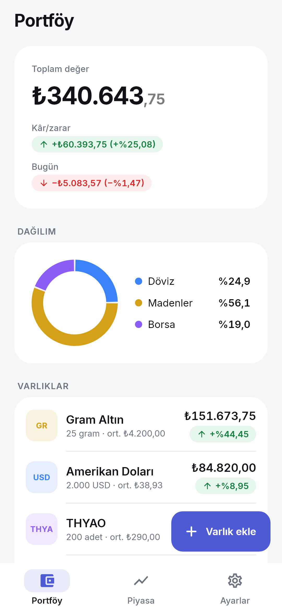
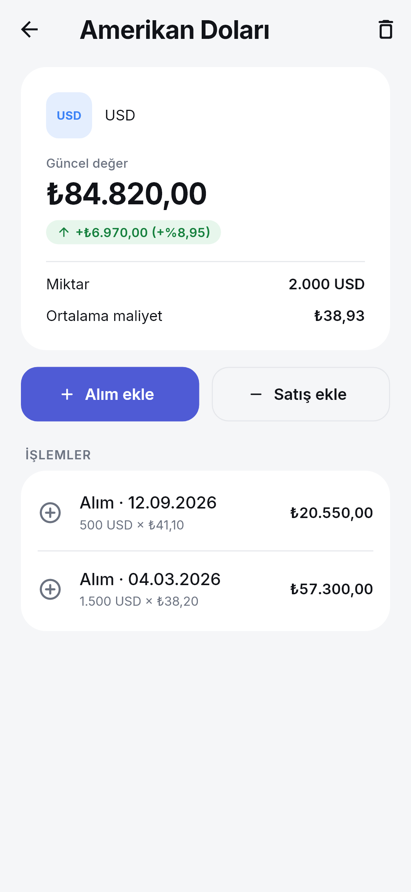
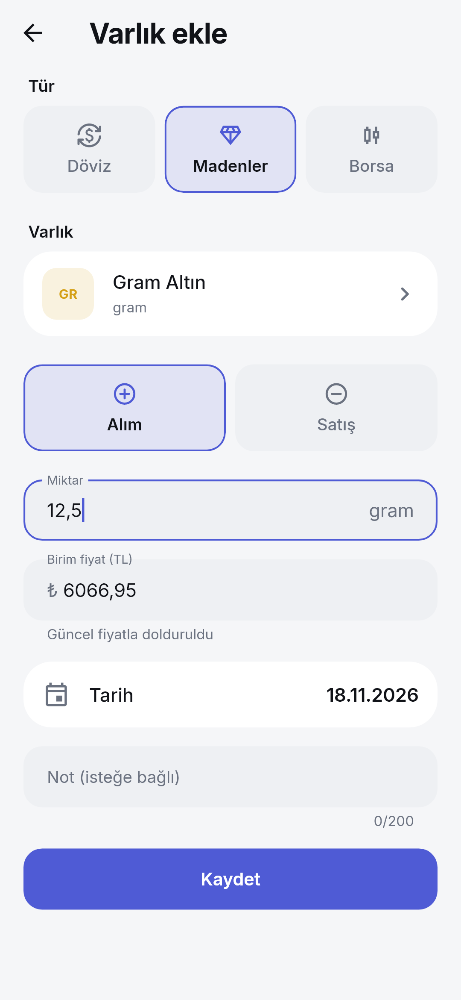
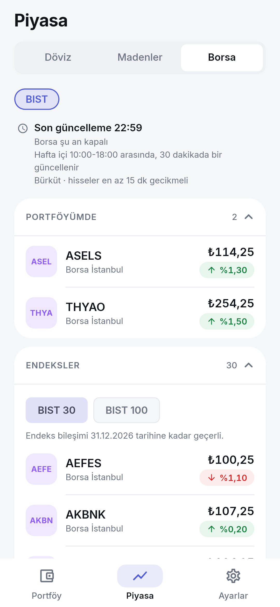

# Faz 4: Özellikler

**Durum:** Bitti · **Tarih:** 2026-11-18

## Özet

Uygulama artık uçtan uca kullanılabilir. Kullanıcı:
- döviz, altın/gümüş ve BIST hissesi ekleyebilir; alım/satım işlemlerini düzenleyip silebilir,
- portföyünün toplam değerini, kâr/zararını, günlük değişimini ve kategori dağılımını (halka grafik) görebilir,
- her varlığın detayını ve işlem geçmişini inceleyebilir.

Fiyat güncelleme ekranı ve "son güncelleme" göstergesi Faz 3'te tamamlanmıştı (Piyasa sekmesi).

| Portföy (aydınlık) | Portföy (karanlık) | Varlık detayı | Varlık ekleme |
|---|---|---|---|
|  |  |  |  |

Ekran görüntülerindeki portföy ve fiyatlar **örnek veridir**.

## Alınan kararlar

| Karar | Alternatif | Gerekçe |
|---|---|---|
| BIST hissesi **arama listesinden** seçilir | Sembolü elle yazmak | Kullanıcı tercihi. Yanlış sembol girilemez, şirket adı görünür. Liste yoksa (anahtar yok) sembol elle yazılabilir |
| Hisse listesi Bürküt `/stocks` (tüm piyasa, **1 istek**) ile alınır, `app_settings`'te JSON olarak (~25 KB) **7 gün** önbelleklenir | Her açılışta çekmek; ayrı tablo | Kota korunur; ayrı tablo için migration gerekmez. Yenileme başarısızsa eski liste kullanılır |
| Alım formunda fiyat, tarih **bugünse** önbellekteki güncel fiyatla dolu gelir | Hep boş | Kullanıcı tercihi. Geçmiş tarih seçilince otomatik doldurulan fiyat temizlenir; kullanıcı fiyatı değiştirirse dokunulmaz |
| Dağılım **halka grafik**, kendi `CustomPainter`'ımızla | Grafik paketi (fl_chart vb.) | Kullanıcı tercihi; paket eklemeye gerek yok. Yüzdeler `Decimal` ile hesaplanır, `double`'a yalnızca çizim için çevrilir |
| Değerleme: miktar × önbellekteki fiyat. Fiyatı olmayan varlık listede "Fiyat yok" olarak durur, **toplamlara katılmaz**, altta not düşülür | Son alış fiyatıyla değerlemek | Uydurma değer göstermemek |
| Kâr/zarar toplamı yalnızca **fiyatı ve maliyeti bilinen** varlıklardan | Bilinmeyen maliyeti 0 saymak | Yüzde bozulmasın (miras altın gibi) |
| Günlük değişim: önceki kapanış = fiyat / (1 + %/100) | Ayrı API çağrısı | Ek istek yok; Bürküt günlük yüzdeyi zaten veriyor |
| Hisselerde başlık **sembol** (THYAO); şirket adı detayda | Şirket adı | Bürküt adları uzun ve büyük harf ("TURK HAVA YOLLARI A.O."); listede kesiliyordu |
| Ekleme ve düzenleme **tek form** (`TransactionFormScreen.add/.edit`) | İki ayrı ekran | Tek kaynak; doğrulama use case'lerde |
| Form ve detay ekranları **kök navigator'da** (alt menünün üstünde) | Sekme içinde | Tam ekran form, geri tuşu doğal çalışır |
| Türkçe sayı girişi: `12,5` · `1.250,75` · `1250.75` · `1.250` (= 1250) | Yalnızca nokta | Türk kullanıcı alışkanlığı (`parseDecimalInput`) |
| Bildirimler (snackbar) **sıraya girmez**, öncekinin yerine geçer | Varsayılan kuyruk | Testte bulundu: "Varlık silindi" mesajı önceki "İşlem kaydedildi"nin arkasında saniyelerce bekliyordu |

## Yapılanlar

### Domain

| Dosya | İçerik |
|---|---|
| `portfolio/domain/services/portfolio_valuator.dart` | Saf değerleme: açık varlıklar, toplam değer, kategori dağılımı, gerçekleşmemiş K/Z (₺ ve %), günlük değişim, fiyatı olmayan sayısı. Sıralama: değere göre azalan, fiyatsızlar sonda |
| `portfolio/domain/entities/portfolio_summary.dart` | `ValuedHolding`, `PortfolioSummary` |
| `portfolio/domain/instrument_catalog.dart` | Seçilebilir dövizler (Bürküt'ün canlıda verdiği 21 kur) ve madenler (gram, çeyrek, yarım, tam, cumhuriyet, ata, gram gümüş) |
| `market/domain/entities/stock_listing.dart` | Sembol + şirket adı |
| `market/domain/providers/price_providers.dart` | Yeni `StockListingProvider` arayüzü |
| `market/domain/repositories/stock_directory_repository.dart` | Önbellekli hisse listesi arayüzü |

### Data

| Dosya | İçerik |
|---|---|
| `burkut_remote_data_source.dart` | `getAllStocks` (`/stocks`, parametresiz) |
| `burkut_price_provider.dart` | `StockListingProvider` uygulaması; `_call` genel tipe çevrildi (anahtar/kota kontrolleri aynen geçerli) |
| `stock_listing_local_data_source.dart` | `app_settings` → `bist_listings` JSON |
| `stock_directory_repository_impl.dart` | 7 gün taze; değilse çek, başarısızsa eski liste; hiç yoksa hata |

### Core

| Dosya | İçerik |
|---|---|
| `utils/decimal_input.dart` | `parseDecimalInput`, `formatDecimalInput` |
| `widgets/donut_chart.dart` | Halka grafik (dilimler arası boşluk, arka iz) |
| `widgets/confirm_dialog.dart` | Silme onayı |
| `widgets/messages.dart` | `ScaffoldMessengerState.showMessage`, kuyruksuz bildirim |
| `router/app_routes.dart` | Rota sabitleri ve yardımcıları (`assetDetail`, `editTransaction`, `addTransactionFor`) |
| `router/app_router.dart` | Kök navigator anahtarı; `/portfolio/add`, `/portfolio/asset/:id`, `/portfolio/asset/:id/transaction/:tx` |

### Sunum (`portfolio/presentation/`)

| Dosya | İçerik |
|---|---|
| `portfolio_screen.dart` | Özet kartı, dağılım, varlık listesi, "Varlık ekle" butonu, fiyatı olmayanlar notu |
| `widgets/portfolio_summary_card.dart` | Toplam değer (kuruş küçük), K/Z ve bugün hapları |
| `widgets/allocation_card.dart` | Halka grafik ve açıklama (Döviz / Madenler / Borsa) |
| `widgets/holding_tile.dart` | Ad, "25 gram · ort. ₺4.200,00", değer, K/Z % |
| `widgets/instrument_picker_sheet.dart` | Kategoriye göre liste (güncel fiyatlarla); hisselerde arama (sembol veya ad, Türkçe büyük harf), listede yoksa elle sembol |
| `screens/transaction_form_screen.dart` | Tür, varlık, alım/satım, miktar (birimli), birim fiyat (otomatik doldurma), tarih, not; düzenlemede silme |
| `screens/asset_detail_screen.dart` | Değer, K/Z, miktar, ortalama maliyet, gerçekleşen K/Z; Alım/Satış ekle; işlem listesi; varlığı silme |
| `screens/edit_transaction_route.dart` | Rota parametrelerinden varlık ve işlemi yükler |
| `portfolio_labels.dart` | Kategori adı ve rengi, görünen ad, birim (USD / gram / adet), hata mesajları |
| `portfolio_providers.dart` | `holdingsProvider`, `portfolioSummaryProvider`, `assetTransactionsProvider(assetId)` |

### Metinler

`app_tr.arb`'ye yaklaşık 50 yeni metin eklendi: form, detay, onaylar, hatalar, seçici. Fazla satış uyarısı şöyle: "Bu tarihte elindeki miktardan fazla satamazsın; önceki bir alım silinirse ya da azalırsa da olmaz".

## Testler

Toplam **153 test**, hepsi geçti (Faz 3 sonunda 127, +26).

| Dosya | Kapsam |
|---|---|
| `test/features/portfolio/domain/portfolio_valuator_test.dart` | Toplam, maliyet, K/Z %, kategori dağılımı, sıralama; fiyatsız varlığın hariç tutulması; bilinmeyen maliyet; günlük değişim (+%25 → önceki 400, şimdi 500); kapalı pozisyon |
| `test/core/decimal_input_test.dart` | 10 Türkçe ve İngilizce biçim; geçersiz girişler; biçimle → ayrıştır gidiş-dönüşü |
| `test/features/market/data/stock_directory_repository_impl_test.dart` | İlk çekme ve sıralama; 6 gün istek yok; 7. gün yenileme; hata → eski liste; liste ve anahtar yok → hata |
| `test/features/portfolio/presentation/portfolio_flow_test.dart` | **Uçtan uca arayüz:** dolar ekle (fiyat otomatik dolu) → portföyde ₺4.210,00 ve dağılım; fazla satış uyarısı; detaydan işlemi düzenle (100 → 200 USD); varlığı sil → boş portföy |
| `test/app_test.dart` | Drift akışlarının kapanış zamanlayıcıları için her testin sonunda uygulama kaldırılıyor |

## Doğrulama

| Komut | Sonuç |
|---|---|
| `dart format --set-exit-if-changed lib test` | Temiz |
| `flutter analyze` | No issues found |
| `flutter test` | 153/153 |
| `flutter build apk --debug` | Başarılı |
| Görsel önizleme (geçici golden test, Inter fontu ile) | Portföy (aydınlık/karanlık), detay, ekleme formu; iki düzeltme yapıldı (hisse başlığı sembol, "Madenler" etiketi) |

## Sonradan yapılan düzeltme: seans kapalıyken eklenen hisse (2026-11-18)

**Kullanıcı geri bildirimi:** Seans kapalıyken eklenen hisse "Fiyat yok" olarak kalıyordu, çünkü hisseler yalnızca seans içinde isteniyordu.

**Yeni kural** (`RefreshPolicy.isMissingStocksDue`):
- Portföydeki bir hissenin önbellekte **hiç fiyatı yoksa**, seans kapalı olsa bile **yalnızca o hisse** için hemen istek atılır.
- Hisse eklenir eklenmez tetiklenir; denetleyici `heldStockSymbolsProvider` değişimini dinliyor.
- Diğer hisseler eskisi gibi yalnızca seans içinde 30 dakikada bir güncellenir.
- Fiyat gelmeyen bir sembol, otomatik yenilemede 30 dakikada bir denenir; elle yenileme hemen dener.
- Hisselerin "son güncelleme" zamanı artık tutulan hisselerin en **eski** fiyat zamanı. Yalnızca yeni hisseyi çekmek, diğerlerini taze göstermesin diye.
- Normal hisse isteği de "eksik hisse" bekleme süresini başlatır. Testte bulundu: başarısız normal istekten hemen sonra eksik hisse yolu tekrar deniyordu.

Testler (157): seans dışında eklenen hissede sadece o sembol isteniyor, 5 dk sonra tekrar istenmiyor; ertesi sabah tüm hisseler birlikte güncelleniyor; fiyat dönmeyen sembol her dakika denenmiyor.

## Sonradan eklenen: piyasada "Portföyümde / Tümü" ve BIST 30 / 100 (2026-11-18)

**İstek:** Her piyasa sekmesinde açılıp kapanan iki bölüm olsun: portföydeki enstrümanlar ve tümü. Borsada "tümü" yerine BIST 30 / BIST 100 seçenekleri olsun. Soru: API isteği artar mı?

**Cevap: Artmaz.**
- `/forex` ve `/gold` zaten tüm listeyi tek istekte getiriyordu.
- `/stocks` parametresiz çağrılınca tüm piyasayı (634 hisse) yine **tek istekte** döndürüyor, yani portföydekileri istemekle aynı maliyet.
- Hisselerde düzenli güncelleme artık tüm piyasayı çekiyor. Bunun yan faydası: seans kapalıyken eklenen hissenin fiyatı son seansın anlık görüntüsünden hazır geliyor. Yalnızca anlık görüntüde olmayan bir sembol (ör. yeni halka arz) için tek hisselik istek atılıyor.

**Endeks verisi:** Bürküt'te yok. Kullanıcının anahtarıyla denendi: `/indices` → 404 (kotadan düşmedi), `/stocks?index=XU030` → parametre yok sayıldı, 634 hissenin tamamı döndü (1 istek). Bu yüzden BIST 30 ve BIST 100 üyeleri `assets/data/bist_indices.json` dosyasında tutuluyor:
- Kaynak: 2026 4. çeyrek dönemi (1 Ekim - 31 Aralık 2026) listesi, Milliyet Uzmanpara'dan 2026-11-18'de alındı.
- Duyurulan dönem değişiklikleriyle karşılaştırıldı (BIST 30'a TRMET girdi, DSTKF çıktı). BIST 30 ⊂ BIST 100 ve tüm semboller Bürküt piyasa listesinde var.
- Dönem bitince ekranda "Endeks listesi … tarihli, güncel olmayabilir" uyarısı çıkıyor.
- Dosya her çeyrek güncellenmeli.

**Arayüz:**
- `CollapsibleSection`: açılır-kapanır kart. Durumu sekme değişince korunuyor (`PageStorage`).
- Her sekmede iki bölüm var: **Portföyümde** (sayı ile) ve **Tümü** (Borsa'da **Endeksler**, BIST 30 / BIST 100 seçimiyle). Portföyde o kategoriden bir şey yoksa ikinci bölüm açık başlıyor.
- Hisse satırlarında alt yazı artık şirket adı (piyasa verisinden geliyor).

| Döviz | Borsa, Endeksler |
|---|---|
|  |  |

**Kod:**
- `StockPriceProvider.fetchQuotes({symbols})`: `null` = tüm piyasa.
- `MarketRepository.refresh(stockSymbols: null)` aynı şekilde.
- Denetleyici: düzenli hisse güncellemesi elde hisse olmasa da yapılıyor. Hisselerin "son güncelleme" zamanı, tutulan hisselerin en eskisi; tutulan hisse yoksa en yeni anlık görüntü.
- Yeni: `BistIndices`, `bistIndicesProvider`, `selectedBistIndexProvider`, `heldInstrumentsProvider`.

**Testler (164):**
- Endeks dosyası bütünlüğü: 30 ve 100 tekil sembol, alt küme, sembol biçimi, geçerlilik.
- Tüm piyasa tek istek.
- Anlık görüntüde olan yeni hisse için istek gitmiyor; anlık görüntüde olmayan hisse için yalnızca o sembol isteniyor.
- Ertesi seans yine tüm piyasa güncelleniyor.

## Bilinen eksikler / sonraki faza devredilenler

- **ABD borsası:** Finnhub'dan yazılı onay bekleniyor (Faz 3 dokümanı).
- **Hisse listesi:** Bürküt anahtarı girilince kendiliğinden yenilenmiyor; ekleme ekranı ilk açıldığında çekiliyor.
- **Tarih:** Yalnızca gün olarak saklanıyor. Aynı güne ait işlemler kayıt sırasına göre işleniyor.
- **Faz 5'e kalanlar:** hata ekranları ve boş durum cilası, erişilebilirlik taraması, yedekleme/dışa aktarma, README, APK yayını.
