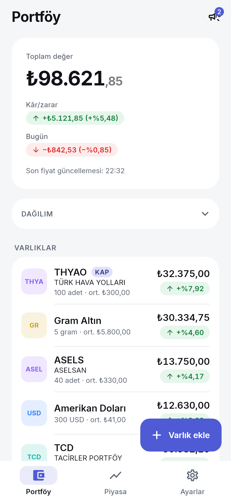
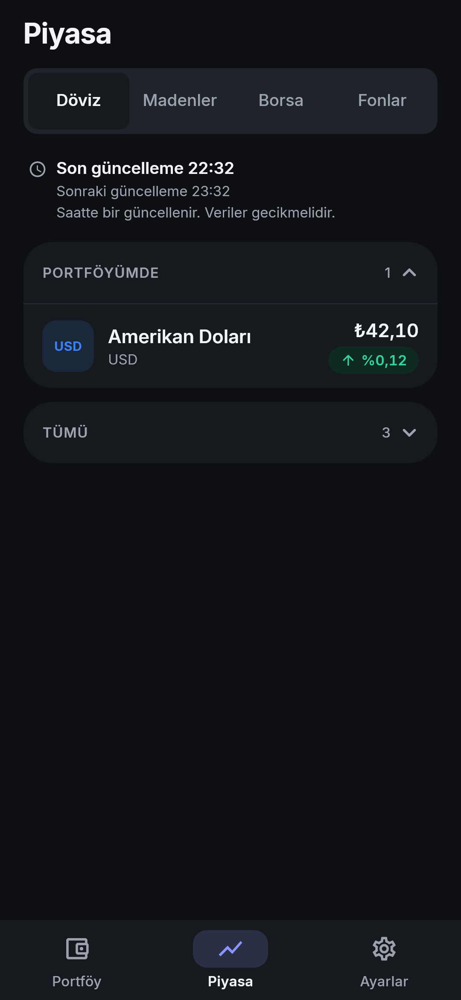
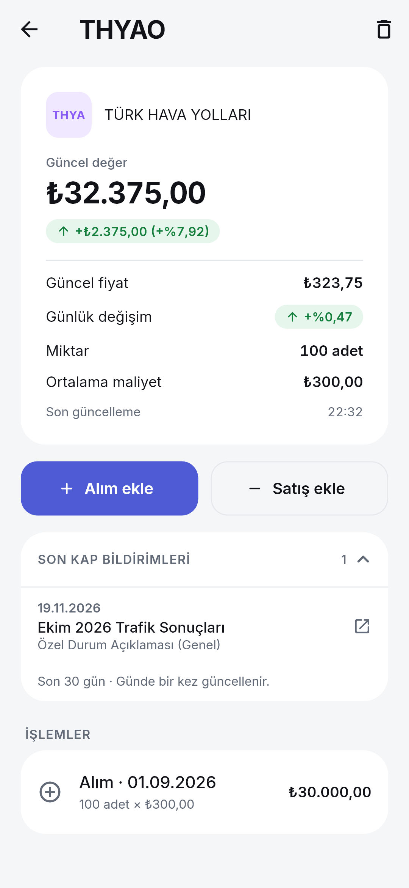

# Faz 5: Cila ve yayın

**Durum:** Bitti (APK yayını ayrı yapılacak) · **Tarih:** 2026-11-19

## Özet

Uygulama paylaşıma hazırlandı:
- **Yedekleme:** portföy tek bir JSON dosyasına aktarılıp başka cihazda geri yüklenebiliyor.
- **Erişilebilirlik:** büyük yazı boyutunda taşma yok; dokunma alanı, etiket ve kontrast kuralları otomatik testle denetleniyor.
- **Hata durumları:** veritabanı okunamazsa boş ekran yerine hata ekranı çıkıyor.
- **Paylaşım dosyaları:** Türkçe README (ekran görüntüleri, kurulum, API anahtarı, veri kuralları, uyarılar) ve MIT LICENSE eklendi. Bürküt'ün "resmi uygulama değildir" şartı README'nin en üstünde.

GitHub Releases ile APK yayını kullanıcı isteğiyle **sonraya bırakıldı**.

| Portföy | Piyasa (karanlık) | Hisse detayı |
|---|---|---|
|  |  |  |

Ekran görüntülerindeki portföy ve fiyatlar **örnek veridir**.

## Alınan kararlar

| Karar | Alternatif | Gerekçe |
|---|---|---|
| Flutter **3.44.6'da kalındı** | 3.50'ye yükseltme + `material.dart` → `material_ui` | Kullanıcı kararı. Uygulama sorunsuz; yükseltme görünür bir yenilik getirmiyor, tüm import'ları değiştiriyor ve kullanıcının SDK'sını günceller. ROADMAP'te bekleyen olarak kaldı |
| Yedekleme **dışa + içe aktarma** | Yalnız dışa aktarma; hiç yok | Kullanıcı kararı. Telefon değişince portföy taşınabilsin |
| Yeni paketler: **`share_plus`** (paylaşım menüsü), **`file_picker`** (dosya seçme) | Dosyayı İndirilenler'e yazmak (depolama izni) | İzin gerekmez; kullanıcı Drive, e-posta, mesajlaşma ya da "Dosyalar'a kaydet" seçer. Kullanıcı onayladı |
| Yedek biçimi: JSON, `{"app":"capira","format":1,...}` (eski `vestra` yedekleri de okunur), tutarlar **metin** | İkili / SQLite kopyası | Okunabilir, sürümlenebilir; `Decimal` hassasiyeti korunur. Şema değişse de okunabilir |
| Yedekte **yalnızca varlıklar ve işlemler** | Fiyatlar, KAP, ayarlar | Fiyat/KAP yeniden çekilir; **API anahtarı asla dosyaya girmez** (güvenlik kuralı) |
| Geri yükleme **mevcut portföyün yerine** geçer, onayla | Birleştirme | Basit ve öngörülebilir; çift kayıt riski yok. Dosya tamamen doğrulanmadan hiçbir şey silinmez; değiştirme tek veritabanı işlemi |
| Doğrulama elle girişle **aynı kurallar** (pozitif miktar, negatif olmayan fiyat, eldekinden fazla satış yok, yinelenen varlık yok) | Sadece biçim kontrolü | Bozuk ya da elle değiştirilmiş dosya tutarsız portföy yaratmasın |
| Lisans **MIT** | Apache-2.0, GPL-3.0 | Kullanıcı kararı. En yaygın ve serbest; "garanti yok" maddesi var |
| README **Türkçe** | İngilizce | Hedef kitle Türkiye'deki kullanıcılar; arayüz de Türkçe |
| İkincil metin rengi `#6B7280` → **`#636A77`** | Olduğu gibi | WCAG AA (4,5:1) arka planda 4,47'de kalıyordu |
| KAP rozeti **vurgu rengi** (kırmızı değil) | Material varsayılanı kırmızı | Kırmızı uygulamada yalnızca zarar demek; kontrast da yetersizdi |
| Piyasa sekmeleri 46 dp (dokunma alanı 48) | 36 dp | Android dokunma alanı kuralı |

## Yapılanlar

### 1. Yedekleme
- **Domain:** `entities/portfolio_backup.dart` (`PortfolioBackup`, `BackupAsset`, `BackupFailure` + `BackupProblem`: `notABackup`, `newerFormat`, `invalidData`), `repositories/backup_repository.dart`, `usecases/backup_use_cases.dart` (`ExportPortfolio`, `ReadBackup` doğrulamalı, `RestoreBackup`).
- **Data:** `data/backup/backup_codec.dart` (biçim 1, belgesi dosyada), `repositories/backup_repository_impl.dart`, `PortfolioLocalDataSource.getAssetsWithTransactions` ve `replaceAll` (tek işlem).
- **Presentation:** `presentation/backup_files.dart` (`BackupFiles` arayüzü; testte bellekte sahte), `widgets/backup_section.dart` (Ayarlar → **Yedekleme**: "Portföyü dışa aktar", "Yedekten geri yükle", onay penceresi tarih/varlık/işlem sayısını gösterir). Dosya adı `capira-yedek-YYYY-AA-GG.json`.
- `confirmDestructive`'e isteğe bağlı `confirmLabel` ("Geri yükle").

### 2. Erişilebilirlik
- `test/accessibility_test.dart`:
  - 360 dp telefonda **1,8× yazı boyutuyla** tüm ana ekranlar gezilir, taşma olmamalı.
  - Portföy, Piyasa ve Ayarlar'da Flutter'ın `androidTapTargetGuideline`, `labeledTapTargetGuideline`, `textContrastGuideline` kuralları.
- **Düzeltmeler:**
  - `ChangeChip` metni sarılıyor.
  - Yeni `TrailingFigures` (satırın sağındaki tutar + çip; ekranın en fazla %36'sı, gerekirse küçülür): `HoldingTile` ve `QuoteTile`.
  - Dağılım lejantı dar ekranda grafiğin altına geçiyor.
  - "KAP" etiketi sığmazsa adın altına iniyor (`Wrap`).
  - Kontrast ve sekme yüksekliği düzeltmeleri (yukarıda).
- Tüm `IconButton`'ların ipucu (tooltip) metni var; KAP etiketinin ekran okuyucu metni "Son 24 saatte KAP bildirimi var".

### 3. Hata durumları
- Yeni `core/widgets/error_state.dart` ("Veriler okunamadı · Uygulamayı kapatıp yeniden aç").
- Portföy ekranı, varlık detayı ve piyasa sekmeleri veritabanı hatasında bunu gösteriyor; önceden boş portföy gibi görünüyordu.
- Ağ hataları bu ekranı açmaz; son bilinen fiyatlar gösterilmeye devam eder.

### 4. README, LICENSE, ekran görüntüleri
- `README.md` (Türkçe):
  - Uyarılar: resmi Bürküt uygulaması değildir, yatırım tavsiyesi değildir, gecikmeli veri, Bürküt lisanslı dağıtıcı değildir, garanti yok.
  - Özellikler, kurulum (Flutter 3.44.6), API anahtarı, veri/güncelleme tablosu, geliştirme ve lisans.
- `LICENSE`: MIT.
- `docs/images/readme-{light,dark}-{portfolio,market,detail}.png`: geçici bir golden testiyle örnek veriden üretildi, test silindi.

### 5. İsim değişikliği: Vestra → Capira (2026-11-19)

- **Neden:** Google Play'de "Vestra" adında bir uygulama vardı. Kullanıcı yeni bir isim istedi.
- **Araştırılan adaylar:** Hazne, Kıymet, Akçe, Folyo ve Capira için web araması yapıldı. Capira'nın kullanımları:
  - OCLC'nin kütüphane uygulaması ürünü CapiraMobile.
  - Dubai'de bir yatırım danışmanlık şirketi (Capira Capital).
  - Doğrudan bir finans uygulaması çakışması bulunmadı.
  - Kullanıcı bilgilendirildikten sonra **Capira**'yı seçti.
- **Değişenler:**
  - Görünen ad ve tüm metinler.
  - Dart paket adı `vestra` → `capira` (tüm import'lar).
  - `VestraApp` → `CapiraApp`, `VestraColors`/`context.vestraColors` → `CapiraColors`/`context.capiraColors`.
  - Veritabanı dosyası `capira`, log etiketi, `drift_schemas/capira`, `test/drift/capira`.
- **Uygulama kimliği:** `com.vestra.vestra` → **`io.github.oomerkaya.capira`** (GitHub kullanıcı adına bağlı; başka bir uygulamayla çakışmaz).
  - Telefonda eski Vestra'dan **ayrı bir uygulama** olarak kurulur; veriler kendiliğinden taşınmaz.
  - Taşıma: Vestra'da Ayarlar → Yedekleme → dışa aktar, Capira'da geri yükle.
- **Eski yedekler:** `BackupCodec` hem `"app": "capira"` hem eski `"vestra"` yedeklerini okur (test var). Yeni dosya adı `capira-yedek-YYYY-AA-GG.json`.
- **Değişmeyenler:** Faz 0-4 dokümanları tarihî kayıt olarak eski adı kullanır. Test fixture'ları Bürküt cevabıdır, isimden bağımsızdır.
- **GitHub repo adı:** Kullanıcı tarafından `Vestra` → `Capira` yapılacak. README'deki klon adresi yeni adı gösteriyor; GitHub eski adresi yeni adrese yönlendirir.

## Doğrulama

```
flutter analyze   → No issues found
flutter test      → 202 test, hepsi geçti
```
Yeni testler:
- `backup_test.dart`: kodlayıcı gidiş-dönüş, yabancı/yeni sürüm/bozuk dosya, doğrulama, iki veritabanı arası dışa→içe aktarma.
- `backup_flow_test.dart`: Ayarlar'dan dışa aktarma, portföyü değiştirip geri yükleme, yabancı dosyanın reddi.
- `accessibility_test.dart`: büyük yazı, Flutter kuralları, veritabanı hatası ekranı.

## Sonraya kalanlar

- **GitHub Releases ile APK** (kullanıcı sonra bakacak). İmzalama anahtarı (`key.properties`) git dışında tutulmalı.
- **Flutter 3.50 + `material_ui` geçişi** (CI sürümüyle birlikte).
- **Bürküt'e repo linki:** e-posta taslağı kullanıcıya verildi; gönderim kullanıcıda. İsterse GitHub repo açıklamasına da "Bürküt'ün resmi uygulaması değildir" yazılabilir (şart README ile zaten karşılanıyor).
- İleride değerlendirilebilir: Bürküt `/corporate-actions` (bedelsiz artırımlarda lot/maliyet düzeltmesi), `/stocks/history` (fiyat grafikleri), aramada Türkçe harf eşitleme ("Türk" ↔ "TURK").
- Bekleyen: ABD borsası (Finnhub yazılı onayı).
