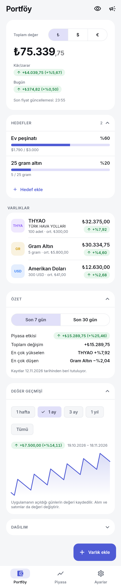
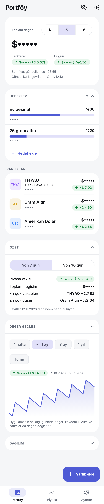

# Faz 6: Kişisel analiz

**Durum:** Bitti · **Tarih:** 2026-11-19

## Özet

Capira'yı özgün kılmak için kullanıcının seçtiği beş özellik eklendi. Hiçbiri API kotası harcamaz:

1. **Toplamlar ₺ / $ / € olarak:** portföy değeri ve kâr/zarar dolar veya euro cinsinden görülebiliyor.
2. **Gizlilik modu:** göz simgesiyle kişisel tutarlar ve miktarlar maskeleniyor.
3. **Değer geçmişi grafiği:** portföyün günlük değeri telefonda kaydediliyor; 1 hafta, 1 ay, 3 ay, 1 yıl ve tümü aralıklarında grafik.
4. **Haftalık / aylık özet:** değişimin ne kadarı alım/satımdan, ne kadarı fiyatlardan geldi; en çok yükselen ve düşen. Kullanıcı isteğiyle KAP yok.
5. **Birikim hedefleri:** portföy değeri (₺/$/€) ya da varlık miktarı ("25 gram altın") için ilerleme çubuğu.

| Portföy (₺) | Dolar + gizlilik modu |
|---|---|
|  |  |

Ekran görüntülerindeki portföy, geçmiş ve hedefler **örnek veridir**.

## Alınan kararlar

| Karar | Alternatif | Gerekçe |
|---|---|---|
| Para birimi seçeneği **yalnızca ₺, $, €** | Gram altın da | Kullanıcı kararı |
| Dönüşüm **güncel alış kuruyla**; maliyet ve işlem fiyatları **TL kalır** | Geçmiş kurlarla dolar bazında getiri | Geçmiş kur verisi yok. Kâr/zarar dolar karşılığına çevrilir ama yüzde TL bazındadır. Karttaki "Güncel kurla çevrildi · 1 $ = ₺42,10" notu bunu açıkça söyler |
| Kur yoksa (anahtar yok, ilk açılış) seçenek **gösterilmez**, ₺'ye düşülür | Hata | Uydurma değer gösterilmez |
| Gizlilik modu: **kişisel tutarlar ve miktarlar** gizlenir; yüzdeler, piyasa fiyatları ve grafik şekli görünür | Her şeyi gizlemek | Yüzde ve grafik şekli mutlak serveti açığa çıkarmaz; piyasa fiyatları kişisel değil |
| Gösterim tek bir yerden: `AmountDisplay` (InheritedWidget) + `AmountFormat` | Her widget'ta ayrı ayrı provider okumak | Para birimi ve gizlilik her ekranda tutarlı; Riverpod bilmeyen widget'lar da kullanabilir |
| Değer geçmişi **cihazda, günde bir satır** (`portfolio_snapshots`), gün içinde son değer üzerine yazılır | Bürküt `/stocks/history` | **0 istek.** Döviz/altın/fon geçmişi o uç noktada yok; portföy toplamı zaten cihazda hesaplanıyor. Dezavantajı: geçmiş kullanıma başlanan günden itibaren birikir, uygulamanın açılmadığı günler boşluktur (grafik altında yazıyor) |
| Günlük satırda **o günün USD/EUR kuru** da saklanır | Bugünün kuruyla çevirmek | Dolar grafiği, her günün kendi kuruyla doğru çizilir |
| Özetteki "en çok yükselen/düşen" için **varlık bazında günlük fiyat** (`asset_snapshots`) | Yalnızca toplam | Fiyat değişimi alımdan bağımsız ölçülür |
| Özet, değişimi **piyasa etkisi** ve **alım/satım** olarak ayırır | Sadece değer farkı | Yeni alım "kâr" gibi görünmesin |
| Özet: son 7 gün / son 30 gün (kayan pencere) | Takvim haftası/ayı | Pazartesi sabahı da anlamlı. Geçmiş daha kısaysa "Kayıtlar X tarihinden beri tutuluyor" notu |
| Hedef türleri: **portföy değeri** (₺/$/€) ve **varlık miktarı** | Tek tür | "25.000 $" ve "100 gram altın" iki ayrı ihtiyaç |
| Portföy ekranında sıra: özet kartı → **Hedefler** → **Varlıklar** → **Özet** → **Değer geçmişi** → **Dağılım** (kapalı) | Analizler varlıkların üstünde | Varlıklar ana bilgi; analizler altta. Hedefler motivasyon için üstte |
| **Şema v4:** `portfolio_snapshots`, `asset_snapshots`, `goals` | — | Geçiş yalnızca tablo oluşturur; v3→v4 veri koruma testi var |

## Yapılanlar

### Para birimi ve gizlilik
- `core/domain/display_currency.dart` (`DisplayCurrency`: tryLira/usd/eur, sembol ve kur kodu).
- `Formatters.money` / `signedMoney` (herhangi bir sembol); `currencyTry` bunlara yönlendi.
- `SettingsRepository`: `display_currency` ve `privacy_mode` (`app_settings`).
- `settings/presentation/display_preferences.dart`: `displayCurrencyProvider`, `privacyModeProvider` (kalıcı).
- `core/widgets/amount_display.dart`: `AmountFormat` (`money`, `signedMoney`, `private`, maske `•••••`) ve `AmountDisplay`. `CapiraApp` bunu `MaterialApp.builder` ile tüm ağaca veriyor (`amountFormatProvider`).
- `MoneyText`, özet kartı (₺/$/€ seçici, 48 dp), `HoldingTile`, varlık detayı (değer ve K/Z dönüşür; ortalama maliyet ve işlemler TL, gizlenir).
- Portföy AppBar'ında göz simgesi ("Tutarları gizle/göster").

### Değer geçmişi ve özet
- **Domain:**
  - `entities/portfolio_snapshot.dart`.
  - `services/snapshot_builder.dart` (İstanbul günü anahtarı).
  - `services/period_summary_calculator.dart` (temel gün seçimi, net alım/satım, piyasa etkisi, en iyi/kötü).
  - `repositories/snapshot_repository.dart`, `usecases/snapshot_use_cases.dart` (`RecordSnapshot`).
- **Data:** `repositories/snapshot_repository_impl.dart`.
- **Presentation:**
  - `snapshot_recorder.dart`: değerleme değişince 5 sn bekleyip bugünü yazar; testlerde kapalı.
  - `core/widgets/line_chart.dart`: paketsiz çizgi grafik.
  - `widgets/value_history_section.dart`, `widgets/period_summary_section.dart`.
- Provider'lar: `snapshotsProvider`, `allTransactionsProvider`, `periodSummaryProvider`.

### Hedefler
- **Domain:** `entities/goal.dart` (`Goal`, `GoalDraft`, `GoalProgress`, `GoalValidationFailure`), `services/goal_calculator.dart`, `repositories/goal_repository.dart`, `usecases/goal_use_cases.dart` (`SaveGoal`, `DeleteGoal`).
- **Data:** `repositories/goal_repository_impl.dart`.
- **Presentation:**
  - `widgets/goals_section.dart`: ilerleme çubukları, "Ulaşıldı", "Hedef ekle".
  - `screens/goal_form_screen.dart`: ad, tür, ₺/$/€ ya da varlık seçici, hedef, silme.
  - Rotalar `/portfolio/goal`, `/portfolio/goal/:goalId`.
- `categoryIcon` ortak oldu; `instrumentShortName` eklendi.

## Doğrulama

```
flutter analyze   → No issues found
flutter test      → 224 test, hepsi geçti
```
Yeni testler:
- `display_test.dart`: dönüşüm, maskeleme, göz simgesi, dolar.
- `snapshot_and_summary_test.dart`: gün anahtarı, anlık görüntü, temel gün, piyasa etkisi/alım ayrımı, günlük üzerine yazma.
- `goals_test.dart`: ilerleme, doğrulama, kaydet/düzenle/sil, ekrandan hedef ekleme.
- v3→v4 migration testi.
- Erişilebilirlik testi yeni bölümleri de geziyor (büyük yazı, dokunma alanı, kontrast).

## Bilinen sınırlar / sonraya

- Dolar/euro bazında **gerçek getiri** (alım günündeki kurla) için alım anındaki kurun saklanması gerekir; şu an yüzde TL bazında.
- Değer geçmişi ve özet yalnızca uygulamanın açıldığı günlerden oluşur (bilinçli; arka plan yok).
- İleride: enflasyona karşı reel getiri, temettü/bedelsiz (`/corporate-actions`), ana ekran widget'ı, uygulama kilidi.
