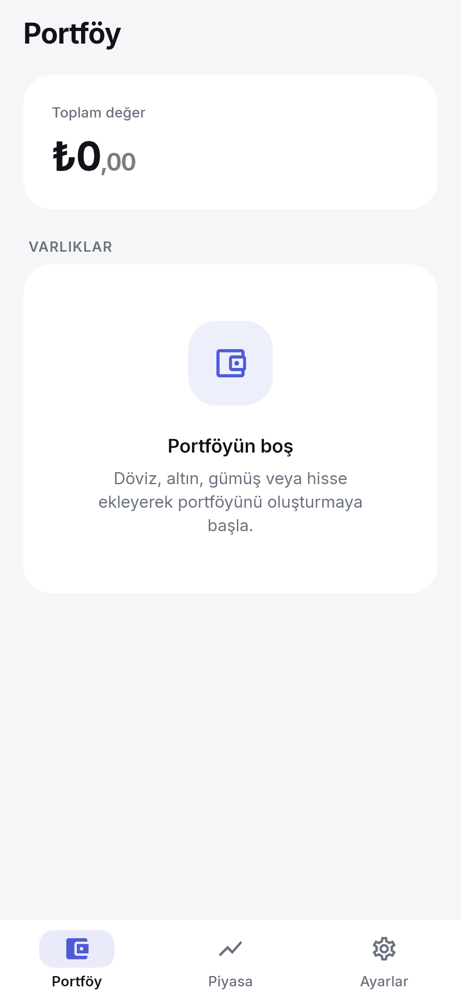
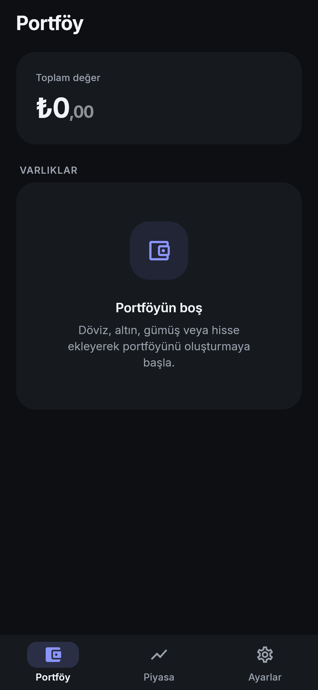
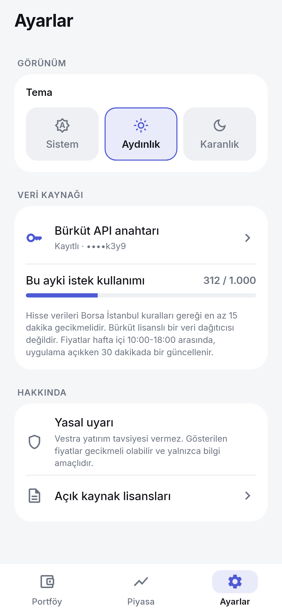
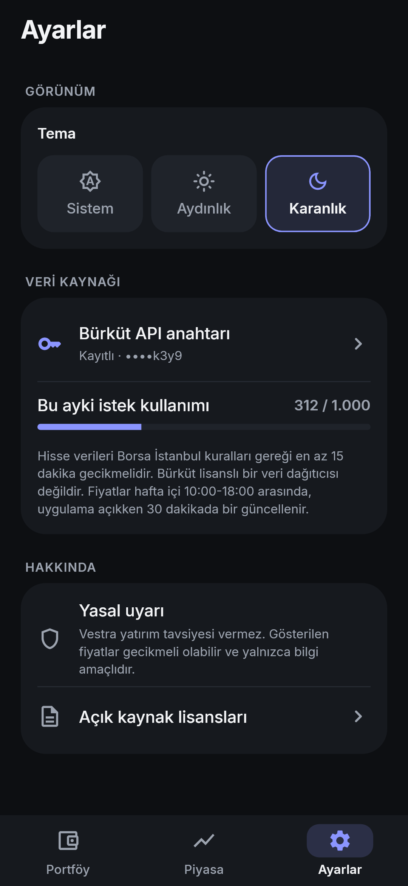

# Tasarım Sistemi

**Tarih:** 2026-11-17 · Faz 2 ile Faz 3 arasında, Faz 4 ekranlarından önce kuruldu.

## Özet

Vestra'nın görsel dili **sade fintech**: nötr arka plan, kenarlıksız yuvarlak kartlar, tek vurgu rengi (indigo), bol boşluk. Yeşil ve kırmızı **yalnızca kâr/zarar** için kullanılır. Yazı tipi **Inter**; tutarlarda eşit genişlikte rakamlar (tabular figures) kullanılır, böylece listelerde rakamlar alt alta hizalanır.

Neden şimdi yapıldı: Faz 4'te yazılacak bütün ekranlar bu temelin üzerine kurulacak. Sonradan eklenseydi her ekranın tekrar elden geçmesi gerekirdi.

| Aydınlık | Karanlık |
|---|---|
|  |  |
|  |  |

## Alınan kararlar

| Karar | Alternatifler | Gerekçe |
|---|---|---|
| Sade fintech tarzı | Koyu premium, renkli/canlı | Kullanıcı tercihi. Finans verisinde okunabilirlik ön planda |
| Inter yazı tipi, uygulamaya gömülü | Manrope, sistem fontu (Roboto); `google_fonts` paketi | Fintech standardı, tam Türkçe karakter desteği, tabular rakamlar. Gömülü olduğu için çevrimdışı çalışır, ağ isteği yapmaz |
| 4 ağırlık (400/500/600/700), statik TTF | Variable font | Flutter'da statik ağırlıklar daha güvenilir. Toplam ~1,6 MB (APK'da sıkıştırılır) |
| Renkler `ThemeExtension` (`VestraColors`) ile | Sabit renkleri doğrudan kullanmak | Açık/koyu tema geçişi otomatik olur, widget'lar tema bilmeden doğru rengi alır |
| Sayı biçimlendirme `Decimal` üzerinde, elle | `intl` `NumberFormat` | `NumberFormat` `double` ister. Kendi biçimlendiricimizle gösterilen değer, saklanan değerin birebir yuvarlanmış hali olur |
| Tema seçici için özel `ChoiceTiles` | Material `SegmentedButton` | `SegmentedButton` dar ekranda "Aydınlık" kelimesini ikiye bölüyordu; karanlık temada seçili seçenek de seçilmemiş gibi görünüyordu (önizlemede tespit edildi) |

## Kaynak

Inter v4.1, resmi sürüm: `github.com/rsms/inter/releases` → `extras/ttf/`. Lisans SIL Open Font License 1.1. [`assets/fonts/inter/OFL.txt`](../assets/fonts/inter/OFL.txt) uygulamaya gömülü ve `main.dart`'ta `LicenseRegistry`'ye kayıtlı; Ayarlar → Açık kaynak lisansları ekranında görünür.

## Tokenlar

### Renkler ([`app_colors.dart`](../lib/core/theme/app_colors.dart))

| Rol | Aydınlık | Karanlık |
|---|---|---|
| Vurgu (primary) | `#4F5BD5` | `#8B95FF` |
| Arka plan | `#F5F6F8` | `#0D0F12` |
| Kart yüzeyi | `#FFFFFF` | `#16191E` |
| Soluk yüzey (input, seçenek) | `#EEF0F3` | `#1F232A` |
| Birincil metin | `#111318` | `#F3F4F6` |
| İkincil metin | `#6B7280` | `#9CA3AF` |
| Ayraç | `#E5E7EB` | `#262B33` |
| Kazanç | `#15803D` | `#34D399` |
| Kayıp | `#DC2626` | `#F87171` |

Varlık türü işaret renkleri (avatar ve küçük işaretler için, Faz 4): döviz `#3B82F6`, altın `#D4A017`, gümüş `#94A3B8`, hisse `#8B5CF6`.

Kullanım: `Theme.of(context).colorScheme.primary`, `context.vestraColors.gain`. `AppPalette` doğrudan kullanılmaz.

### Boşluk, köşe, süre ([`app_tokens.dart`](../lib/core/theme/app_tokens.dart))

- `AppSpacing` (4'lük ızgara): `xxs 2`, `xs 4`, `sm 8`, `md 12`, `lg 16`, `xl 24`, `xxl 32`, `xxxl 48`, `screen 20` (ekran yan boşluğu)
- `AppRadius`: `sm 8`, `md 12`, `lg 16` (buton, input), `xl 24` (kart), `pill`
- `AppDurations`: `fast 150ms`, `normal 250ms`

Kural: Widget'larda çıplak sayı (`EdgeInsets.all(13)`) kullanılmaz, token kullanılır.

### Tipografi ([`app_typography.dart`](../lib/core/theme/app_typography.dart))

| Stil | Boyut / ağırlık | Kullanım |
|---|---|---|
| `displaySmall` | 34 / 700, tabular | Toplam portföy değeri |
| `headlineSmall` | 24 / 700 | Ekran başlığı (AppBar) |
| `titleMedium` | 16 / 600 | Kart başlığı |
| `titleSmall` | 14 / 600 | Grup başlığı |
| `bodyLarge` / `bodyMedium` | 16 / 14, 400 | Metin |
| `bodySmall` | 12 / 400, ikincil renk | Açıklama |
| `labelLarge` | 14 / 600 | Buton |
| `labelMedium` | 12 / 500, ikincil renk | Etiket, bölüm başlığı |

Başlıklarda hafif negatif harf aralığı var (modern, sıkı görünüm).

## Bileşen temaları ([`app_theme.dart`](../lib/core/theme/app_theme.dart))

- **AppBar:** Arka planla aynı renk, kaydırınca gölge yok, başlık sola dayalı ve büyük.
- **Card:** Gölgesiz, kenarlıksız, 24 köşe.
- **NavigationBar:** Yüzey renginde, 68 yükseklik. Seçili sekme vurgu renginin %12 tonunda yuvarlak gösterge içinde, etiketler hep görünür.
- **FilledButton / OutlinedButton:** 52 yükseklik, tam genişlik, 16 köşe.
- **Input:** Dolgulu (soluk yüzey), kenarlıksız; odakta vurgu renginde 1,5 kenarlık.
- **BottomSheet:** Üstte 28 köşe, sürükleme tutamacı.
- **SnackBar:** Yüzer, 12 köşe.
- **FAB:** Vurgu renginde, gölgesiz, 16 köşe.

## Ortak widget'lar (`lib/core/widgets/`)

| Widget | Ne yapar |
|---|---|
| `AppCard` | Standart kart; isteğe bağlı `onTap` ile dokunma efekti |
| `SectionHeader` | Kart grubunun üstündeki küçük, büyük harfli başlık; sağda isteğe bağlı aksiyon |
| `MoneyText` | TL tutarı, tabular rakamlarla. `emphasizeInteger` ile kuruş kısmı küçük ve soluk (`₺248.320`,`45`) |
| `ChangeChip` | Kâr/zarar hapı: ▲ yeşil, ▼ kırmızı, — nötr |
| `ChoiceTiles` | 2-4 seçenekli kare seçici (ikon üstte, etiket altta); seçili olan vurgu tonu + kenarlık |
| `EmptyState` | Vurgu tonlu kutuda ikon + başlık + açıklama + isteğe bağlı buton |
| `InstrumentAvatar` | Türe göre renkli kare (döviz mavi, altın sarı, gümüş gri, hisse mor), kısa etiket (Faz 3) |

## Sayı biçimlendirme ([`formatters.dart`](../lib/core/utils/formatters.dart))

| Fonksiyon | Örnek |
|---|---|
| `currencyTry` | `₺248.320,45`, `−₺35,10` |
| `signedCurrencyTry` | `+₺3.120,00`, `−₺1,50`, `₺0,00` |
| `percent` | `%1,26`, `+%1,27` (`signed`), `−%0,50` |
| `number` | `42,5`, `1.250` (sondaki sıfırlar atılır), `trimZeros: false` → `42,50` |

Kurallar: binlik ayıracı `.`, ondalık `,`, `₺` ve `%` önde (Türkçe kullanım), eksi işareti tipografik `−` (U+2212). Yuvarlama sıfırdan uzağa (yarım yukarı).

## Ekranlara uygulananlar

- **Portföy:** Büyük başlık, "Toplam değer" kartı (`₺0,00`, kuruş vurgusuz), "VARLIKLAR" bölümü ve kart içinde boş durum.
- **Piyasa:** Kart içinde boş durum.
- **Ayarlar:** "GÖRÜNÜM" bölümünde `ChoiceTiles` tema seçici. "HAKKINDA" bölümünde yasal uyarı ve açık kaynak lisansları.

## Doğrulama

| Komut | Sonuç |
|---|---|
| `flutter analyze` | No issues found |
| `flutter test` | 52/52 geçti (8 yeni biçimlendirici testi dahil) |
| Golden önizleme (geçici test, Inter + Material ikon fontu yüklenerek) | Aydınlık/karanlık × Portföy/Ayarlar ekran görüntüleri yukarıda |

## Kurallar (CLAUDE.md'ye de eklendi)

- Renk, boşluk ve köşe için token kullan; çıplak değer yazma.
- Yeşil/kırmızı yalnızca kâr/zarar için.
- Tutarlar `MoneyText` / `Formatters` ile gösterilir, asla `double.toString()` ile.
- Yeni ortak bileşen gerekiyorsa önce `core/widgets`'a bak; yoksa oraya ekle.
